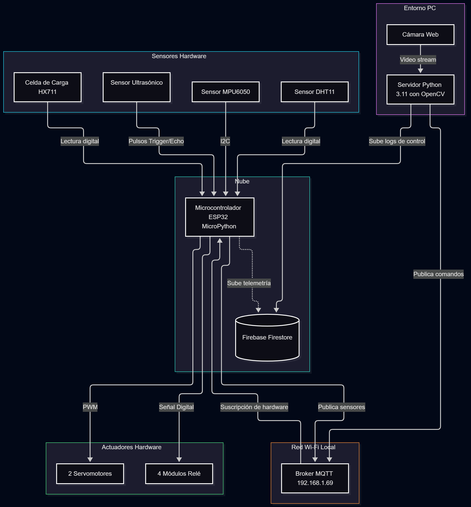

# OMNISERVE


> **Semestre:** ago-dic-2026
> **Materia:** Sistemas Programables — ISC TecNM León
> **Integrantes:**

| Nombre | Matrícula | Rol | GitHub |
|--------|-----------|-----|--------|
| Diego Jahzeel Mendez Martinez | 23240829 | 🔧 Firmware ESP32 🧠 Servidor Python/IA ☁️ Firebase/Interfaz | @Catu21 |
| Joshua Maximiliano Anguiano Contreras | 23240329 | 🔩 Hardware/Carcasa 📝 Documentación | @usuario |

---

## 📌 Descripción General

Explica en 2–3 oraciones:
- ¿A quién ayuda este proyecto?
- ¿Qué problema resuelve?
- ¿Cómo lo resuelve de forma diferente a lo que ya existe?

OmniServe ayuda a usuarios que requieren automatizar mecanismos físicos de servicio o dispensación sin depender del contacto manual, resolviendo el problema de la interacción física y la inestabilidad de los sensores ambientales tradicionales. A diferencia de las alternativas convencionales, lo resuelve integrando inteligencia artificial con reconocimiento facial para detonar rutinas de hardware (servomotores y relés) a través de una conexión MQTT blindada con un ESP32, garantizando una ejecución robusta y un registro de control en tiempo real en Firebase.

## 🏗️ Arquitectura del Sistema



### Tópicos MQTT

| Tópico | Dirección | Descripción |
|--------|-----------|-------------|
| `omniserve/temp` | ESP32 → Broker | Lectura DHT11 |
| `omniserve/distancia` | ESP32 → Broker | Lectura Ultrasonico |
| `omniserve/peso` | ESP32 → Broker | Lectura HX711 |
| `proyecto/cam/frame` | ESP32-CAM → Broker | Frame de cámara |
| `proyecto/actuador1/cmd` | Broker → ESP32 | Comando actuador 1 |
| `proyecto/actuador2/cmd` | Broker → ESP32 | Comando actuador 2 |
| `proyecto/actuador3/cmd` | Broker → ESP32 | Comando actuador 3 |

---

## 🛠️ Hardware

| # | Componente | Tipo | Cantidad | Costo aprox. MXN |
|---|-----------|------|----------|-----------------|
| 1 | ESP32 DevKit | Microcontrolador | 1 | $120 |
| 2 | ESP32-CAM | Cámara | 1 | $130 |
| 3 | _Sensor 1_ | Sensor | 1 | |
| 4 | _Sensor 2_ | Sensor | 1 | |
| 5 | _Sensor 3_ | Sensor | 1 | |
| 6 | _Actuador 1_ | Actuador | 1 | |
| 7 | _Actuador 2_ | Actuador | 1 | |
| 8 | _Actuador 3_ | Actuador | 1 | |
| 9 | _Componente estrella_ | No convencional | 1 | |
| **Total** | | | | **< $800 MXN** |

### Diagrama de conexiones

> Inserta aquí una imagen que muestre cómo están conectados los componentes.
> Puede ser un diagrama hecho en cualquier herramienta (Fritzing, draw.io, Canva, foto del circuito, etc.).
> Guarda la imagen en `hardware/` y actualiza la ruta abajo.


---

## 💻 Software y Firmware

### Requisitos del servidor Python

```bash
pip install -r servidor/requirements.txt
```

### Cómo ejecutar el sistema completo

**1. Levantar el broker MQTT** (en una terminal aparte):
bash
mosquitto -v

**2. Cargar firmware en la ESP32:
Abrir Thonny → conectar la ESP32 por USB → cargar el archivo main.py y las librerías de los sensores a la placa. (Asegúrate de que la IP del broker 192.168.1.69 esté configurada en el código antes de subirlo). 

**3. Ejecutar el servidor de IA
# Asegúrate de tener la cámara web conectada
python main_ia.py


### Librerías ESP32 (MicroPython - corren en la placa)

| Librería | Uso |
|----------|-----|
| `umqtt.simple` | Cliente MQTT en la ESP32 |
| `machine` | Control de pines GPIO (PWM para servos, I2C y pines digitales) |
| `network` | Conexión WiFi |
| `time` | Manejo de pausas (delays) y medición de tiempos |
| `dht` | Lectura del sensor de temperatura y humedad DHT11 |
| `hx711` | Lectura de la celda de carga para el peso |
| `mpu6050` | Lectura del acelerómetro y giroscopio (comunicación I2C) |
| `hcsr04` | Lectura de distancia del sensor ultrasónico |

### Librerías servidor Python (corren en la PC)

| Librería | Versión | Uso |
|----------|---------|-----|
| paho-mqtt | ≥ 1.6 | Cliente MQTT en el servidor |
| opencv-python | ≥ 4.8 | Procesamiento de imagen |
| firebase-admin | ≥ 6.0 | Escritura en Firestore |
| opencv-python | ≥ 4.8 | Modelo IA: haarcascade_frontalface_default.xml |

---

## 🧠 Inteligencia Artificial

- **Modelo:** OpenCV (Clasificador en cascada Haar - `haarcascade_frontalface_default.xml`).
- **Qué detecta:** Rostros humanos frontales en tiempo real a través de la transmisión de la cámara web.
- **Cómo toma decisiones:** Si detecta un rostro en pantalla, espera a que pase el tiempo de enfriamiento (4 segundos) y publica una secuencia escalonada de comandos MQTT para mover 2 servomotores a 90° y encender 4 relés, registrando el evento simultáneamente en Firebase.
- **Confianza mínima aceptada:** Alta (parametrizado con `minNeighbors=5` y `scaleFactor=1.1`, lo que exige al menos 5 detecciones superpuestas para confirmar un rostro y evitar falsos positivos).

---

## 🎥 Demostración

**Video demostrativo (YouTube):** [▶️ Ver video](https://youtube.com/watch?v=XXXXXXXX)

### Fotos del prototipo final

| Vista frontal | Vista interna | Sistema en operación |
|--------------|---------------|----------------------|
|  |  |  |

---

## 📋 HAL — Hardware Abstraction Layer

| #  | Componente         | Tipo     | Pin ESP32   | Tópico Publicación         | Tópico Suscripción     | Unidad | Rango  |

| :  |                    |          |             |                            |                        |        |        |

| 1  | DHT11              | Sensor   | GPIO 4      | `omniserve/temp`           | -                      | °C     | 0-50   |

| 2  | Ultrasónico        | Sensor   | GPIO 13, 34 | `omniserve/distancia`      | -                      | cm     | 2-400  |

| 3  | HX711              | Sensor   | GPIO 35, 32 | `omniserve/peso`           | -                      | g      | 0-5000 |

| 4  | Pantalla OLED      | Display  | GPIO 21, 22 | -                          | `omniserve/pantalla`   | -      | -      |

| 5  | Bomba 1 / rele     | Actuador | GPIO 23     | -                          | `omniserve/bomba1/cmd` | -      | ON/OFF |

| 6  | Bomba 2 / rele     | Actuador | GPIO 26     | -                          | `omniserve/bomba2/cmd` | -      | ON/OFF |

| 7  | Bomba 3 / rele     | Actuador | GPIO 27     | -                          | `omniserve/bomba3/cmd` | -      | ON/OFF |

| 8  | Bomba 4 / rele     | Actuador | GPIO 14     | -                          | `omniserve/bomba4/cmd` | -      | ON/OFF |

| 9  | Servo 1            | Actuador | GPIO 18     | -                          | `omniserve/servo1/cmd` | °      | 0-180  |

| 10 | Servo 2            | Actuador | GPIO 19     | -                          | `omniserve/servo2/cmd` | °      | 0-180  |

| 11 | ESP32-CAM          | Cámara   | -           | `omniserve/cam/frame`      | -                      | JPEG   | -      |


---

## 🔥 Esquema Firebase

```
/nombre-proyecto/
  /lecturas/{timestamp}/
      sensor1: valor
      sensor2: valor
      sensor3: valor
  /eventos_ia/{timestamp}/
      deteccion: "clase"
      accion: "actuador_ON"
      confianza: 0.92
  /estado_actual/
      sensor1: ultimo_valor
      actuador1: "ON"
```

---

## ⚠️ Retos técnicos encontrados

_(Llenar al finalizar el proyecto — esta sección alimenta las conclusiones del reporte)_

1.
2.
3.

---

*Sistemas Programables · ISC TecNM León · ago-dic-2026*
