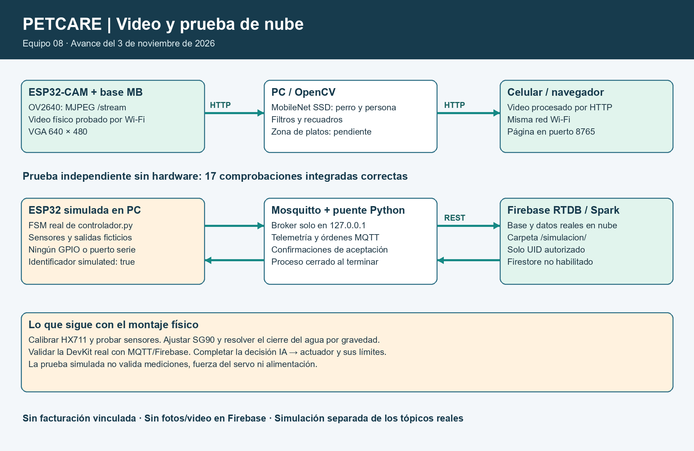

# PetCare — Estación de alimentación, hidratación y monitoreo para perros

> **Servicio final confirmado: Cloud Firestore.** Base creada en Spark sin facturación. Pasaron 49 pruebas unitarias y 22 comprobaciones de Firestore/MQTT con dispositivos simulados. El perfil de PC ya usa Firestore; carga y prueba física pendientes. [Configuración y evidencia](docs/FIRESTORE_2026-11-08.md).

> **Ampliación de software posterior a este corte:** ya se prepararon JPEG por MQTT, decisión IA con señal RGB, ACK, rutas de Firebase y dashboard. Pruebas de software y nube simulada aprobadas; carga y prueba física pendientes. [Estado actualizado y pasos](docs/INTEGRACION_MQTT_IA.md).


> **Equipo:** 08, según el padrón del repositorio del curso.
> **Semestre:** ago-dic-2026
> **Materia:** Sistemas Programables — ISC TecNM León
> **Corte anterior del 8 de noviembre, previo al cambio a Firestore:** cámara y detección móvil confirmadas; lectura RAW, servo sin carga y LED del MOSFET reportados por el equipo. Ampliación de software: frames MQTT, respuesta RGB de IA, dashboard y registro RTDB. Pasaron 38 pruebas de software, 12 comprobaciones de cadena local y 20 con Firebase real y dispositivos simulados. Pendientes carga nueva, gramos, bombeo y cadena física completa. [Reporte del corte](docs/AVANCE_2026-11-08.md).

| Nombre | Matrícula | Rol | GitHub |
|---|---|---|---|
| Brandon Leonel Padilla De la Cruz | 22240293 | Distribución formal por confirmar; integración del avance | [BrandonCruz09](https://github.com/BrandonCruz09) |
| Isaac Eliseo Flores Valencia | 22240324 | Distribución formal por confirmar | Pendiente |
| Lidia Verenice Padilla López | 22240312 | Distribución formal por confirmar | Pendiente |

## 📌 Descripción General

PetCare busca ayudar a quienes cuidan perros a supervisar el alimento disponible, suministrar agua de manera controlada y observar los platos desde la red local. Integra una báscula, detección de presencia y nivel, una compuerta y cámara en una carcasa económica de coroplast con compartimento seco. La automatización completa es un objetivo: este avance implementa acciones solicitadas por panel/MQTT y bloqueos básicos, no alimentación autónoma validada.

## 🏗️ Arquitectura del Sistema



La cámara es una segunda placa. La PC recibe MJPEG por HTTP, ejecuta MobileNet SSD y comparte el video con recuadros en el navegador del celular; el modo JPEG por MQTT ya está preparado y probado en PC con transporte real y cámara simulada; falta cargarlo a la cámara física. El puente utiliza Firebase **Realtime Database**, coherente con el PDF de Unidad 4. El proyecto está en **Spark**, sin facturación vinculada. Se verificaron reglas y lectura/escritura reales para una identidad limitada a datos simulados. Firestore no está habilitado.

### Tópicos MQTT

| Tópico | Dirección | Descripción |
|---|---|---|
| `petcare/equipo8/telemetry` | DevKit → broker → PC | JSON con peso, temperatura, humedad, presencia, nivel y estado |
| `petcare/equipo8/commands` | PC → broker → DevKit | `id` y `action`: `feed`, `water`, `stop_water` |
| `petcare/equipo8/ack` | DevKit → broker → PC | Resultado y motivo de aceptación/rechazo |
| `petcare/equipo8/vision` | PC → broker | Presencia de perro/persona, disponibilidad y recuadros; sin fotografía |

El RGB admite ahora `signal_dog` por MQTT: blanco durante 1.5 s y retorno a la supervisión local. El buzzer conserva lógica local. La ejecución física integral sigue pendiente.

## 🛠️ Hardware

| # | Componente | Tipo | Cantidad | Costo MXN |
|---|---|---|---|---|
| 1 | ESP32 DevKit | Controlador | 1 | Por registrar |
| 2 | ESP32-CAM OV2640 + base ESP32CAM-MB | Cámara/controlador | 1 conjunto | Por registrar |
| 3 | Celda 5 kg + HX711 | Sensor | 1 conjunto | Por registrar |
| 4 | DHT22 | Sensor ambiente | 1 | Por registrar |
| 5 | PIR | Sensor presencia | 1 | Por registrar |
| 6 | Flotador | Sensor nivel | 1 | Por registrar |
| 7 | MG995 | Actuador compuerta | 1; SG90 disponibles de pruebas anteriores | Por registrar |
| 8 | Bomba 3–5 V + módulo MOSFET + diodo | Actuador de agua | Bomba y módulo disponibles; diodo pendiente | Por registrar |
| 9 | LED RGB + 3 resistencias | Indicador | 1 conjunto | Por registrar |
| 10 | Buzzer activo/driver según consumo | Indicador audible | 1 | Por registrar |
| 11 | Fuente regulada 5 V / 5 A | Alimentación | 1 | Por registrar |
| 12 | Coroplast, soportes, jarra azul, bote rojo y platos | Estructura/depósitos | Según medidas reales | Por registrar |

No se inventan costos ni un total. La celda pesa alimento/plato, no al perro.

### Diagrama de conexiones

[Diagramas anteriores](hardware/diagrama.png) — referencia histórica. Para montar, usar la [guía actualizada y los seis acercamientos](hardware/MONTAJE_Y_CONEXIONES.md), con servo GPIO33.

[Tabla HAL y conexiones del avance](hardware/HAL.md). Mapa de señales basado en el código: confirmar modelo de módulos y montaje real antes de alimentar. No es una foto de circuito validado. La plantilla vigente permite diagramas hechos en cualquier herramienta.

## 💻 Software y Firmware

La estructura es modular: `main.py` organiza; `sensores.py` lee y filtra; `controlador.py` maneja la FSM; `actuadores.py` controla salidas; `mqtt_link.py` y `wifi_panel.py` manejan comunicaciones. El HX711 promedia 3 muestras y suaviza peso con 30 % nuevo/70 % anterior; su eficacia física aún debe medirse.

### Requisitos del servidor Python

```powershell
python -m pip install -r servidor/requirements.txt
```

### Cómo ejecutar por etapas

1. **Cámara en Thonny:** usar base ESP32CAM-MB por USB de datos. Elegir MicroPython ESP32 y el puerto detectado. Requiere firmware con módulo `camera`; no sustituirlo por firmware genérico ni borrarlo sin respaldo.
2. Ejecutar `firmware/esp32cam/probar_camara.py`. Debe terminar con tres JPEG válidos y devolver `>>>`.
3. Copiar `wifi_config.example.py` como `wifi_config.py`, completar la red local y guardar en la **cámara** junto con `camara_wifi.py` y `main.py` de `firmware/esp32cam/`. El programa arranca al energizar. Abrir `/foto` o `/stream` en la IP que imprime; cerrar el video directo antes de iniciar el servidor PC. Las claves están excluidas de Git.
4. **DevKit:** conectar componentes según HAL, sin energizar mientras se cablea. Copiar los `.py` de `firmware/esp32/` a la placa. Calibrar con `calibrar_bascula.py` y completar tara/factor en `config.py`. Probar servo sin carga antes del conjunto.
5. Completar red y broker en `config.py` solo localmente; no subir claves. Si MQTT está vacío, el equipo ejecuta supervisión local. Instalar `umqtt.simple` en la DevKit para habilitar MQTT. Ejecutar `main.py`; STOP de Thonny detiene el ciclo.
6. En la PC configurar `server_config.json` a partir del ejemplo; ajustar `camera_stream_url`. Ejecutar `descargar_modelo.py` y `vision_main.py` desde `servidor/`, o usar `iniciar_video.cmd`. Abrir `http://IP_DE_LA_PC:8765/` desde el celular en el mismo Wi-Fi. [Guía de video y detección](docs/VIDEO_Y_DETECCION.md).
7. Para integrar MQTT, iniciar Mosquitto y luego `python servidor/petcare_server.py`. El puente consulta `vision_url` en la PC. Desde la DevKit, el broker es la IP de la PC, no `127.0.0.1`. Firebase permanece desactivado hasta configurar autenticación y reglas. El video funciona sin estos servicios.

El montaje propuesto usa bomba y depósito cerrado por abajo; probar con diodo y corte de flujo verificado antes de integrarlo. La fuente externa y el USB no deben alimentar simultáneamente el mismo riel de 5 V sin aislamiento verificado.

### Librerías ESP32

| Librería | Uso |
|---|---|
| `machine`, `time`, `network`, `socket`, `dht` | Pines, tiempos, red y DHT22 de MicroPython |
| `umqtt.simple` | Cliente MQTT (instalación pendiente en DevKit física) |
| `hx711.py` incluido | Lectura de báscula |
| `camera` incluido en firmware específico | OV2640 en ESP32-CAM |

### Librerías servidor Python

| Librería | Versión declarada | Uso |
|---|---|---|
| paho-mqtt | >=2.0,<3 | MQTT |
| requests | >=2.31,<3 | HTTP cámara y Firebase REST |
| opencv-python-headless | >=4.10,<5 | Decodificación, DNN y recuadros |
| numpy | >=2,<3 | Imágenes y salidas de la red |

### Pruebas reproducibles en PC

```powershell
python -m unittest discover -s servidor -p "test_*.py" -v
```

Son pruebas de lógica con dobles; no certifican funcionamiento físico, conexión cloud ni estabilidad de alimentación.

Para la prueba integrada contra Firebase real, ejecutar `servidor/iniciar_simulacion.cmd` después de completar la configuración privada indicada en [Firebase y simulación](docs/FIREBASE_Y_SIMULACION.md). Inicia Mosquitto solo en la PC, utiliza la FSM del firmware con salidas simuladas y cierra el broker al terminar. Pasaron 17 comprobaciones integradas y 19 pruebas de software. [Resultado guardado](docs/PRUEBAS_FIREBASE_SIMULADA.json).

## 🧠 Inteligencia Artificial

Detectar perros y personas en la PC mediante **MobileNet SSD preentrenado sobre VOC**. No identifica a una persona ni distingue perros individuales. El modelo original se descarga por separado y se verifica con SHA-256; se conserva su licencia MIT.

- El flujo es ESP32-CAM → MJPEG → PC/OpenCV → página web del celular.
- Se dibujan recuadros y se confirma presencia después de tres cuadros. Mínimos: perro 0.60; persona 0.80. No son porcentajes de precisión del sistema.
- El equipo confirmó video y detección de persona/perro en el teléfono. También se reportó un falso positivo de perro como persona; se añadieron umbrales por clase y revisión de recuadros contradictorios. Falta medir su efecto en escenas repetidas.
- La zona de platos está sin ajustar hasta fijar la cámara. La detección no dispensa alimento. La política opcional `dog_indicator_enabled` envía una señal breve al RGB por MQTT; queda pendiente comprobarla en hardware.
- [Funcionamiento, pruebas y límites](docs/VIDEO_Y_DETECCION.md). El envío de decisión IA→MQTT→RGB y el registro en RTDB se probaron con dispositivos simulados. Falta repetirlos con el hardware real.

## 🎥 Demostración

**Video YouTube:** pendiente de grabación. **Fotos de prototipo final:** pendientes; carcasa en fabricación según el equipo.
Evidencia disponible y límites: [avance del 2 de noviembre](docs/AVANCE_2026-11-02.md).

## 📋 HAL — Hardware Abstraction Layer

[Ver tabla completa: pines, tópicos, unidades, estado y dato → acción](hardware/HAL.md).
Los valores de calibración y mediciones reales están pendientes; no se presentan rangos nominales como lecturas.

## 🔥 Esquema Firebase

El puente actual usa **Realtime Database vía REST**, con autenticación anónima y token local excluido de Git:

```text
/petcare/equipo8/latest   → última telemetría
/petcare/equipo8/vision   → resultado de perro/persona y disponibilidad
/petcare/equipo8/command  → solicitud {id, action}
/petcare/equipo8/events   → eventos y confirmaciones
```

Las rutas anteriores son las previstas para el hardware. La prueba usa `petcare/equipo8/simulacion/ID_EJECUCION`, con `simulated: true`, e incorpora `probe` y `report`. Se verificaron datos y confirmaciones en Firebase real; la báscula y los actuadores siguen sin prueba conjunta física. Las reglas autorizan únicamente el UID de la PC en esa carpeta y bloquean el resto. La página local de video no es un dashboard de Firebase. No se incluye una cuenta de servicio ni reglas públicas abiertas.

## ⚠️ Retos técnicos encontrados

1. Reinicio brownout al activar Wi-Fi. Se mantuvo la protección; la conexión USB actual permitió transmitir después. Falta prueba prolongada y alimentación final.
2. Movimiento del servo depende de alimentación y fricción real. Se limita recorrido y se libera PWM en reposo; todavía falta probar la compuerta final.
3. La báscula requiere soporte rígido, tara y calibración; coroplast solo no garantiza medición estable.
4. El depósito rojo debe retener el agua cuando la bomba se apaga. No dejar embudo inferior abierto; verificar que no exista sifonado en el montaje real.
5. La clasificación puede confundir perro/persona; falta medir falsos positivos con la cámara fija.
6. Se corrigió identificación del repo a equipo 08. Firmware y servidor publicados usan `petcare/equipo8`; no mezclar con copias anteriores `equipo9`.

---
Avance inicial para retroalimentación. No es entrega final ni declaración de sistema completo funcionando.

## Organización del cierre

[Plan del 8 al 15 de noviembre y diferencias con la rúbrica](docs/PLAN_SPRINT_3_4.md). [Banco de pruebas independiente](firmware/pruebas/README.md). [Reporte Word del corte](docs/PetCare_Avance_08_noviembre_2026.docx). La estructura exigida en la nueva rúbrica aún debe reconciliarse con `firmware/esp32`, `firmware/esp32cam` y el servidor actual; no se declara cumplida por tener código equivalente.
