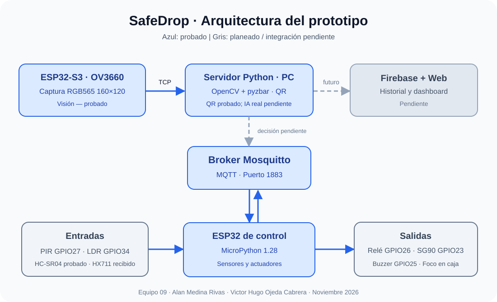
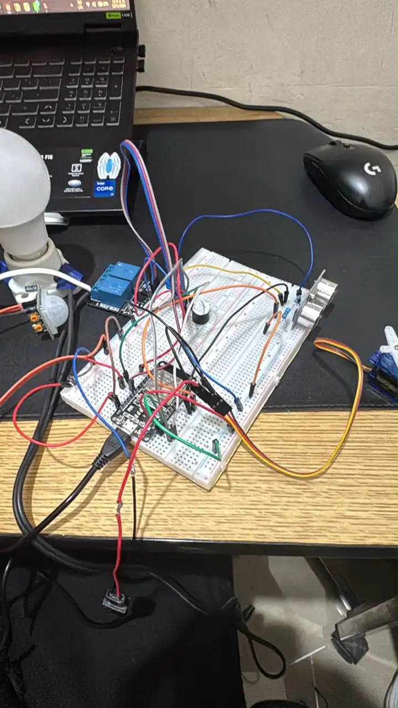

# SafeDrop — Buzón inteligente


> **Semestre:** ago-dic-2026  
> **Materia:** Sistemas Programables — ISC TecNM León  
> **Equipo:** 09  
> **Entrega:** proyecto en desarrollo; este repositorio documenta avances y pruebas, no una entrega final.

## Integrantes

| Nombre | Matrícula | Responsabilidades | GitHub |
|---|---|---|---|
| Alan Medina Rivas | 23240436 | Distribución formal de roles por confirmar | [@Medrivs](https://github.com/Medrivs) |
| Victor Hugo Ojeda Cabrera | 23240390 | Distribución formal de roles por confirmar | Pendiente de registrar |

## 📌 Descripción general

SafeDrop es un buzón inteligente diseñado para facilitar la recepción de
paquetes en ausencia del destinatario y reducir el riesgo de extracción no
autorizada. Utiliza sensores y actuadores conectados a un ESP32 de control,
una segunda ESP32-S3 con cámara y un servidor Python para procesar imágenes
y validar entregas. Se planea registrar eventos en Firebase y visualizarlos
en un dashboard.

**Importante:** la lectura de códigos QR con OpenCV y `pyzbar` ya se probó;
es visión computacional tradicional y no equivale a un modelo de IA
entrenado. El componente de IA requerido por el curso sigue por definir
e integrar.

## 🏗️ Arquitectura del sistema



**Implementado:** ESP32-S3 OV3660 → Wi-Fi/TCP → Python/OpenCV/pyzbar,
y ESP32 de control ↔ MQTT/Mosquitto para sensores y actuadores de prueba.

**Planeado:** decisiones de validación QR → MQTT → SG90, integración de
cámara por MQTT conforme al calendario, histórico Firebase y dashboard.

### Tópicos MQTT

| Tópico | Dirección | Función | Estado |
|---|---|---|---|
| `safedrop/rele/cmd` | Broker → ESP32 | Relé ON/OFF/AUTO (automático PIR + oscuridad) | Probado por separado; integración por verificar |
| `safedrop/sensores/pir` | ESP32 → Broker | 0 / 1 movimiento | Probado |
| `safedrop/sensores/ldr` | ESP32 → Broker | Valor ADC luz | Probado |
| `safedrop/sensores/distancia` | ESP32 → Broker | Distancia HC-SR04 en cm | Probado |
| `safedrop/sensores/peso_raw` | ESP32 → Broker | Lecturas sin calibrar de celda de 5 kg por HX711 | Firmware preparado; prueba pendiente |
| `safedrop/puerta/cmd` | Broker → ESP32 | Apertura/cierre SG90 con ABRIR/CERRAR | Firmware implementado; validación MQTT pendiente |
| `safedrop/buzzer/cmd` | Broker → ESP32 | Buzzer activo ON/OFF | Probado |
| `safedrop/estado/rele` | ESP32 → Broker | Estado ON/OFF del relé integrado | Integrado en código |
| `safedrop/eventos/objeto` | ESP32 → Broker | Detección de objeto por HC-SR04 | Integrado en código |
| `safedrop/estado/puerta` | ESP32 → Broker | Posición ordenada al SG90 (ABIERTA/CERRADA) | Integrado en código |
| `safedrop/cam/frame` | Cámara → Broker | Fotograma de cámara | Propuesto; hoy se usa TCP |

## 🛠️ Hardware

| # | Componente | Tipo | Cantidad | Estado / costo MXN |
|---|---|---|---|---|
| 1 | ESP32 estándar | Microcontrolador | 1 | Disponible / costo no registrado |
| 2 | ESP32-S3 + OV3660 | Cámara / MCU | 1 | Disponible / costo no registrado |
| 3 | PIR HC-SR501 | Sensor | 1 | Probado |
| 4 | LDR LM393 | Sensor | 1 | Probado |
| 5 | HC-SR04 | Sensor | 1 | Distancia y publicación MQTT probadas |
| 6 | Relé de 2 canales 5 V | Actuador | 1 | MQTT probado; foco probado de forma individual en caja protegida |
| 7 | Servomotor SG90 | Actuador | 1 | Movimiento físico probado con fuente regulada; integración MQTT conjunta pendiente |
| 8 | Buzzer activo 3.3 V | Actuador | 1 | MQTT probado individualmente |
| 9 | Celda de carga 5 kg + HX711 | Sensor no convencional | Kit recibido | Pendiente de soldadura si corresponde, cableado, prueba y calibración; GPIO32/33 |
| 10 | Protoboard y cables | Montaje prototipo | Varios | Disponibles |
| 11 | Foco 120/127 V | Iluminación controlada por relé | 1 | Prueba unitaria con relé en caja protegida, reportada por el equipo; integración simultánea pendiente |

**Costo total real:** pendiente de registrar, sin estimaciones inventadas.

### Diagrama de conexiones y Tabla HAL

- [Tabla HAL del hardware, pines, unidades y tópicos](hardware/tabla_hal.md)
- [Guía de montaje del circuito y el HX711 de 5 kg](hardware/montaje_protoboard.md)
- **Esquemático detallado del circuito** (Fritzing o equivalente): pendiente
  de realizar y subir como imagen.
- **Fotografía real del montaje inicial:** disponible en [`media/circuito_safedrop.webp`](media/circuito_safedrop.webp); faltan imágenes del montaje final y la carcasa.

Las conexiones marcadas como *propuestas* no se han validado.
La parte de 120 V requiere instalación protegida y revisión de personal
calificado; no debe cablearse en protoboard.

## 💻 Software y firmware

### Firmware ESP32 de control

Pruebas independientes en [`firmware/esp32-control/`](firmware/esp32-control/):

- `rele_mqtt.py`: comandos ON/OFF para GPIO26.
- `pir_mqtt.py`: eventos 0/1 en GPIO27.
- `ldr_mqtt.py`: nivel analógico por GPIO34 (ADC1).
- `ultrasonico_mqtt.py`: distancia HC-SR04 en cm; TRIG GPIO18, ECHO GPIO19 con divisor de tensión.
- `buzzer_mqtt.py`: buzzer activo 3.3 V, comandos MQTT ON/OFF en GPIO25.
- `servo_mqtt.py`: control independiente del SG90 por GPIO23 mediante comandos ABRIR/CERRAR.
- `hx711.py`: controlador MicroPython para celda de carga mediante HX711 (24 bits).
- `hx711_prueba.py`: lectura y tara inicial para evaluar la celda de carga de 5 kg.
- `config.example.py`: plantilla para la configuración privada.

### Integración del ESP32 de control y sensor no convencional HX711

[`firmware/esp32-control/safedrop_integrado.py`](firmware/esp32-control/safedrop_integrado.py)
reúne **PIR GPIO27, LDR GPIO34, HC-SR04 GPIO18/19, relé GPIO26,
buzzer GPIO25 y SG90 GPIO23** en un solo proceso de MicroPython.
Publica los tres sensores por MQTT. Con movimiento y oscuridad en modo
`AUTO`, acciona el relé de iluminación durante **30 segundos desde la
última detección PIR**; admite además `ON` y `OFF` para pruebas manuales.
Si deja de estar oscuro, se apaga antes. Un objeto cercano provoca un pitido breve.
El SG90 recibe comandos `ABRIR` y `CERRAR` por MQTT.

**Estado:** código integrado y publicado, **prueba simultánea pendiente**.
La lectura de HX711 se activa en `safedrop_integrado.py` con `HX711_HABILITADO = True` después del montaje y la prueba independiente. Al inicio se publicarán cuentas sin calibrar en `safedrop/sensores/peso_raw`; no equivalen a gramos hasta realizar una calibración con una masa conocida.
La parte de baja tensión del relé está incluida, pero la instalación del
**foco de 120/127 V debe hacerse en caja cerrada y revisarse por personal
calificado, nunca en la protoboard**. El equipo reporta que ya efectuó una prueba unitaria del relé con el foco dentro de una caja protegida.
El HX711 y la celda de carga de **5 kg ya se recibieron**; se programó la lectura y resta verificar cableado, calibración e integración. Proximidad no equivale a entrega autorizada.

Publica `safedrop/estado/rele`, `safedrop/estado/puerta` y
`safedrop/eventos/objeto`. Instrucciones y precauciones en el
[README del ESP32 de control](firmware/esp32-control/README.md).

### Visión ESP32-S3

[`firmware/esp32s3-vision/main.py`](firmware/esp32s3-vision/main.py):
captura RGB565 a 160×120 y envía cabecera + imagen por TCP al servidor
Python, puerto 5000. La configuración real va en `config.py`, ignorado
por Git. La configuración separada aún requiere una prueba completa sobre
la placa en su versión publicada.

### Servidor Python

[`servidor/main.py`](servidor/main.py): recibe la imagen, la convierte
con NumPy/OpenCV y utiliza `pyzbar` para leer QR. El reconocimiento
de QR y la recepción de imágenes ya se demostraron en pruebas.

Requisitos actuales: [`servidor/requirements.txt`](servidor/requirements.txt).

```cmd
cd semestres\ago-dic-2026\equipo-09-safedrop\servidor
python -m pip install -r requirements.txt
python main.py
```

### Ejecutar las pruebas MQTT

1. Instalar y configurar Mosquitto en la PC. Broker de pruebas: puerto 1883.
2. Crear un `config.py` a partir del `config.example.py` del firmware
   elegido y establecer SSID, contraseña e IP local del broker.
   **No subir contraseñas ni credenciales a GitHub.**
3. En Thonny ejecutar manualmente **un** script del ESP32 de control.
4. Abrir un CMD con el suscriptor MQTT:

```cmd
"C:\Program Files\mosquitto\mosquitto_sub.exe" -h localhost -t "safedrop/#" -v
```

5. Para enviar una orden de prueba al relé **sin carga conectada**:

```cmd
"C:\Program Files\mosquitto\mosquitto_pub.exe" -h localhost -t safedrop/rele/cmd -m ON
"C:\Program Files\mosquitto\mosquitto_pub.exe" -h localhost -t safedrop/rele/cmd -m OFF
```

### Librerías

**ESP32:** `network`, `machine`, `time`, `umqtt.simple`; firmware
especial con soporte `camera` para ESP32-S3.

**PC:** `opencv-python`, `numpy`, `pyzbar`; Mosquitto como broker.
La integración `paho-mqtt` y `firebase-admin` se evaluará al implementar
el puente MQTT y Firestore; no forman parte aún del servidor publicado.

## 🧠 Inteligencia artificial y visión

- **Técnica probada:** OpenCV + lectura de códigos QR con `pyzbar`.
- **Entrada probada:** fotograma RGB565 a 160×120 desde OV3660.
- **Decisión futura:** comprobar QR válido, vigencia y uso previo antes
  de publicar una autorización de apertura.
- **Modelo IA, confianza mínima y evaluación:** pendientes de definir y
  desarrollar conforme a los requisitos del curso.

## 📋 HAL — Hardware Abstraction Layer

La [tabla HAL completa de avance](hardware/tabla_hal.md) documenta
conexiones verificadas y pines/tópicos propuestos sin confundirlos.

| Componente | GPIO | MQTT | Estado |
|---|---|---|---|
| PIR | 27 | `safedrop/sensores/pir` | Probado |
| LDR (AO) | 34 | `safedrop/sensores/ldr` | Probado |
| HC-SR04 | 18 / 19 (ECHO con divisor) | `safedrop/sensores/distancia` | Probado |
| Relé | 26 | `safedrop/rele/cmd` | Probado |
| SG90 | 23 (PWM) | `safedrop/puerta/cmd` | Movimiento físico confirmado; validación MQTT pendiente |
| Buzzer activo | 25 | `safedrop/buzzer/cmd` | Probado |
| HX711 + celda 5 kg | 32 DOUT / 33 SCK | `safedrop/sensores/peso_raw` | Kit recibido; firmware de lectura implementado; calibración pendiente |

## 🔥 Esquema Firebase (previsto, no implementado)

```text
/safedrop/
  /lecturas/{timestamp}/
    pir: 0 o 1
    ldr: valor_adc
    distancia_cm: valor
  /eventos_ia/{timestamp}/
    qr_validado: true/false
    accion: "abrir" o "rechazar"
  /estado_actual/
    puerta: "cerrada"
    iluminacion: "OFF"
```

El proyecto Firebase, las reglas de seguridad y el dashboard están pendientes.

## 🎥 Demostración y evidencias

### Fotografía del montaje del prototipo



*Evidencia del montaje real en desarrollo. No representa una instalación eléctrica terminada ni segura para energizar: las conexiones de 120/127 V deben aislarse en una caja adecuada y ser revisadas por personal calificado antes de usar el foco.*

- **Video de YouTube:** pendiente de grabar y publicar.
- **Fotos del prototipo final:** pendientes; la foto anterior corresponde al montaje de pruebas.
- **Capturas de OpenCV y mensajes MQTT:** disponibles en pruebas, pendientes
  de incorporarse a la carpeta `media/`.
- **Reporte final PDF:** pendiente de integrar en `docs/`.

## ✅ Avances y pendientes según sprints

| Sprint | Avances confirmados | Pendiente principal |
|---|---|---|
| 1 — Hardware, MQTT y HAL | Sprint 1 aprobado; PIR, LDR, HC-SR04, buzzer, pruebas unitarias del relé con foco y movimiento SG90, Tabla HAL | Verificar firmware conjunto con HX711, evidencias y esquemático |
| 2 — Cámara e IA | Captura OV3660, servidor OpenCV, lectura QR | Modelo real de IA solicitado por la maestra; integrar decisiones IA/QR por MQTT |
| 3 — Firebase y carcasa | Arquitectura planeada; caja protegida del foco ya utilizada en prueba unitaria | Firebase, dashboard, carcasa completa del prototipo |
| 4 — Reporte y video | Commits y documentación inicial | Reporte, fotos, video, entrega final |

## ⚠️ Retos técnicos encontrados

1. La OV3660 funciona en RGB565 a 160×120; resoluciones superiores
   presentaron problemas de captura y desbordamiento de búfer.
2. La cámara envía actualmente bytes RAW vía TCP; el requisito de frames
   por MQTT sigue pendiente.
3. Se requirió configurar Mosquitto para aceptar la comunicación ESP32/PC
   y mantener las credenciales fuera de GitHub.
4. La señal del LDR es inversa a la iluminación (valores altos = menos luz);
   necesita calibración para accionar la iluminación.
5. El HC-SR04 alimentado a 5 V necesita adaptar ECHO a 3.3 V o menos antes de conectarlo al GPIO19.
6. El relé y el foco se probaron de forma individual en caja protegida, según
   lo reportado por el equipo. Para la instalación definitiva se requiere
   mantener el aislamiento y verificar la seguridad del cableado de 120/127 V,
   sin cables de red en protoboard.

---

*Sistemas Programables · ISC TecNM León · ago-dic-2026 · Equipo 09*
