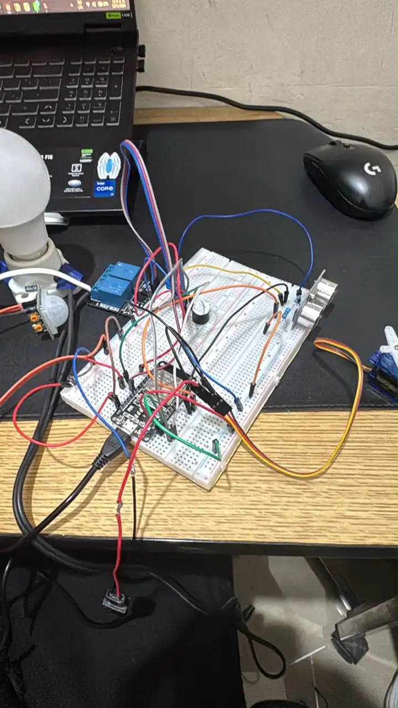

# SafeDrop — Evidencias del prototipo

Esta carpeta contiene las evidencias reales del avance de SafeDrop
para el PR #6. No sustituir fotografías reales por simulaciones.

## Fotografía del montaje actual

- **Archivo:** `circuito_safedrop.webp`.
- **Contenido:** foto del montaje de pruebas con ESP32 de control,
  protoboard, sensores, módulo de relé, foco/portalámparas y SG90.

## Evidencias que todavía faltan

1. **broker_mqtt.png:** captura real de CMD ejecutando
   `mosquitto_sub -h localhost -t "safedrop/#" -v`, mostrando
   tópicos y lecturas publicados por la ESP32.
2. **Foto del montaje definitivo:** componentes fijados y protegidos,
   con el circuito de 120/127 V dentro de una caja adecuada.
   Mostrar el HX711 y la celda de carga de 5 kg una vez instalados.
3. **Evidencia de carcasa y operación final:** pendiente.

Antes de subir capturas, verificar que no aparezcan contraseñas,
credenciales, SSID privados ni información personal innecesaria.
