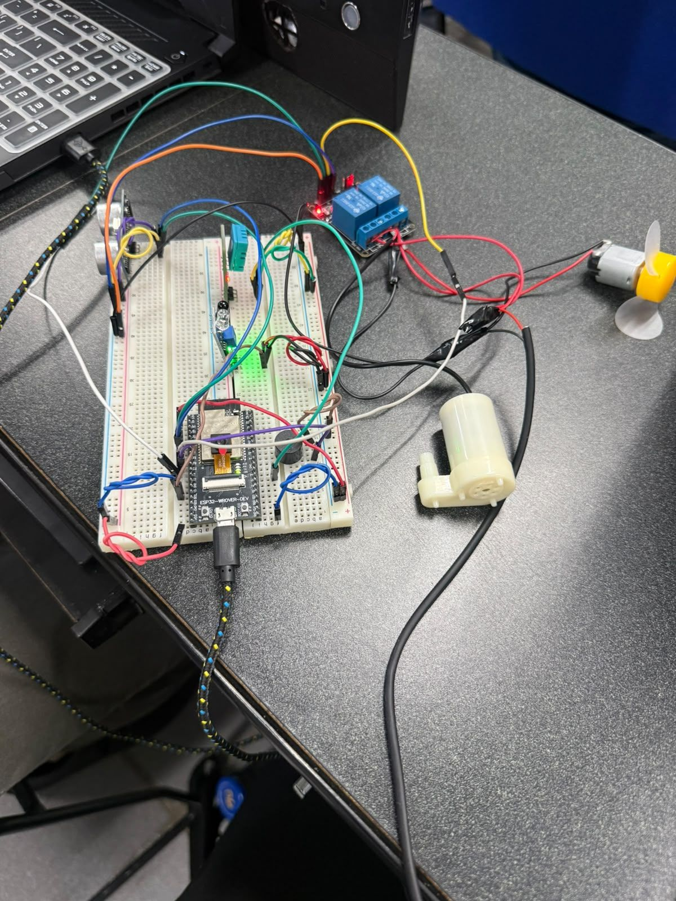
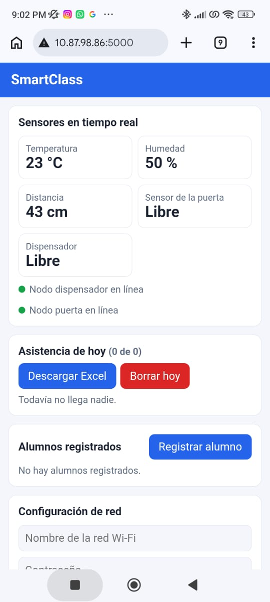
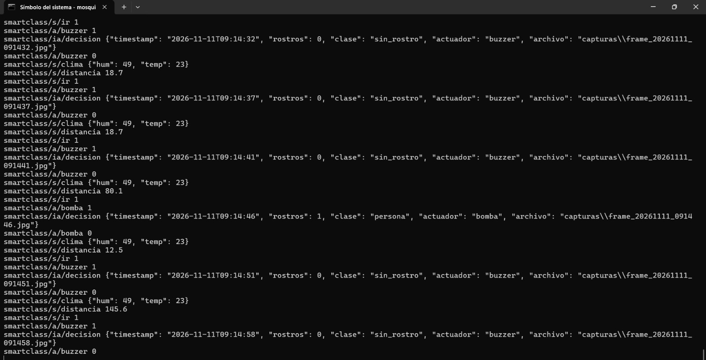
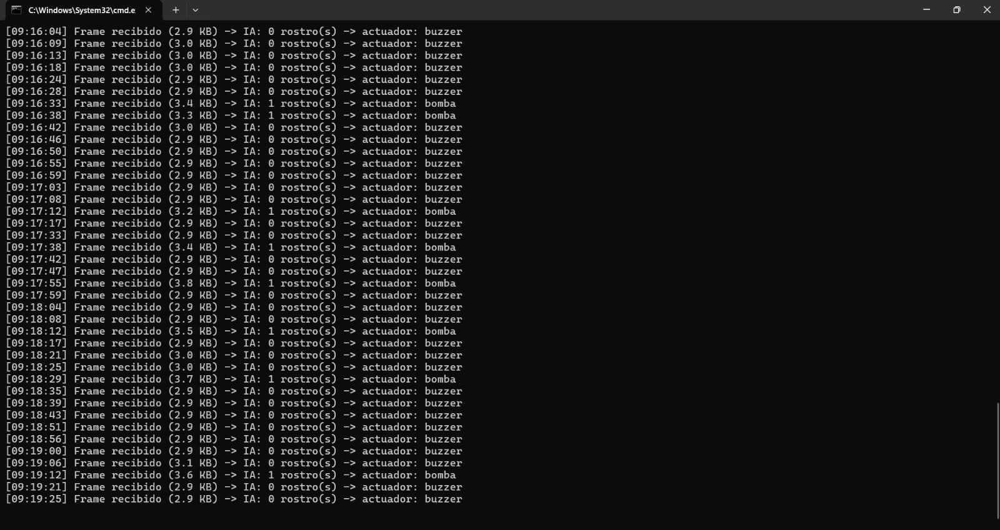
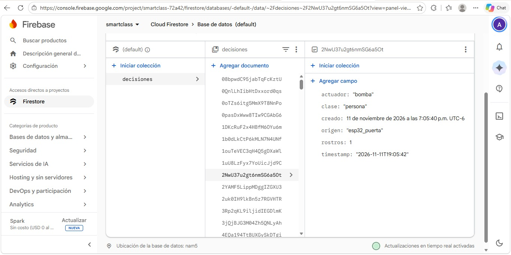

# SmartClass

[](#) [](#) [](#)

> **Semestre:** ago-dic-2026 **Materia:** Sistemas Programables — ISC TecNM León **Integrantes:**

| Nombre                       | Matrícula | Rol                                                      | GitHub      |
|------------------------------|-----------|----------------------------------------------------------|-------------|
| Carrillo Gómez Aldo Emmanuel | 23240343  | 🔧 Código (firmware, servidor, IA, Firebase) · 🔩 Circuito |             |
| Torres Uribe Juan Daniel     | 23240326  | 📝 Documentación · 🔩 Circuito                            | @danielTU03 |

---

## 📌 Descripción General

SmartClass ayuda a profesores, estudiantes y a la institución a ahorrar tiempo de clase, automatizando el pase de lista con reconocimiento facial en la puerta del salón y cuidando el ambiente del aula. Resuelve el problema de que pasar lista consume tiempo, de que no hay un registro confiable de quién entra y de que las condiciones del aula (calor e higiene) no se controlan. A diferencia del pase de lista tradicional, la cámara de la puerta reconoce al alumno con IA y registra su asistencia, un dispensador automático entrega gel al detectar la mano, un ventilador se enciende solo cuando sube la temperatura y el docente ve todo en tiempo real, con histórico en Firebase, desde un dashboard web en su celular.

---

## 🏗️ Arquitectura del Sistema

> 📌 **Inserta aquí tu diagrama de arquitectura como imagen.** No uses texto — coloca una imagen que muestre el flujo completo de tu sistema. Guárdala en `hardware/` y actualiza la ruta abajo.

[](hardware/arquitectura.png)

**Flujo general:** el nodo puerta (ESP32-WROVER con cámara) detecta a una persona y envía fotos por MQTT → el servidor Python detecta y reconoce el rostro con OpenCV → publica el resultado por MQTT → la puerta responde con el anillo LED, el buzzer y la pantalla. El servidor guarda lecturas, decisiones y asistencias en Firebase y muestra todo en el dashboard.

| Nodo        | Placa        | Qué hace                                                                 | Código                  |
|-------------|--------------|--------------------------------------------------------------------------|-------------------------|
| Puerta      | ESP32-WROVER con cámara OV2640 | Detecta personas, toma fotos, muestra el resultado y registra alumnos    | `firmware/cam/main.py`  |
| Dispensador | ESP32 DevKit | Dosifica gel con el sensor IR, mide temperatura y controla el ventilador | `firmware/hal/main.py`  |
| Servidor    | PC (laptop)  | IA, asistencia, Firebase y dashboard web                                 | `servidor/mqtt_bridge.py` |

### Tópicos MQTT

| Tópico                        | Dirección                  | Descripción                                                    |
|-------------------------------|----------------------------|----------------------------------------------------------------|
| `smartclass/cam/frame`        | Puerta → Broker            | Foto de la cámara (JPEG)                                       |
| `smartclass/s/distancia`      | Puerta → Broker            | Distancia en cm (ultrasónico)                                  |
| `smartclass/s/ir`             | Puerta → Broker            | Sensor IR de la puerta (0 / 1)                                 |
| `smartclass/s/clima`          | Dispensador → Broker       | Temperatura y humedad (DHT11), en JSON                         |
| `smartclass/s/ir_disp`        | Dispensador → Broker       | Sensor IR del dispensador (0 / 1)                              |
| `smartclass/e/bomba`          | Dispensador → Broker       | Estado de la bomba (`ON` / `OFF`)                              |
| `smartclass/e/vent`           | Dispensador → Broker       | Estado del ventilador (`ON` / `OFF`)                           |
| `smartclass/nodo/puerta`      | Puerta → Broker            | Latido del nodo puerta (en línea)                              |
| `smartclass/nodo/dispensador` | Dispensador → Broker       | Latido del nodo dispensador (en línea)                         |
| `smartclass/puerta/resultado` | Servidor → Puerta          | Resultado de la IA: `reconocido`, `desconocido` o `sin_rostro` |
| `smartclass/puerta/cmd`       | Servidor → Puerta          | Comandos del registro de alumnos                               |
| `smartclass/a/bomba`          | Broker → Dispensador       | Dosis de prueba de la bomba (`1`)                              |
| `smartclass/a/vent`           | Broker → Dispensador       | Ventilador: `1` encender, `0` apagar, `auto` automático        |
| `smartclass/config/wifi`      | Servidor → Nodos           | Nueva red WiFi enviada desde el dashboard                      |

---

## 🛠️ Hardware

| #  | Componente                                              | Tipo                       | Cantidad | Costo aprox. MXN |
|----|---------------------------------------------------------|----------------------------|----------|------------------|
| 1  | ESP32 DevKit (ESP-WROOM-32), nodo dispensador           | Microcontrolador           | 1        | $120             |
| 2  | ESP32-WROVER con cámara OV2640, nodo puerta             | Cámara y microcontrolador  | 1        | —                |
| 3  | Sensor infrarrojo de obstáculos (puerta)                | Sensor                     | 1        | —                |
| 4  | Sensor infrarrojo de obstáculos (dispensador)           | Sensor                     | 1        | —                |
| 5  | Ultrasónico HC-SR04 con divisor de voltaje (1 kΩ y 2 kΩ en ECHO) | Sensor            | 1        | $35              |
| 6  | DHT11                                                   | Sensor                     | 1        | $40              |
| 7  | Buzzer activo                                           | Actuador                   | 1        | $20              |
| 8  | Módulo relevador de 2 canales                           | Actuador                   | 1        | —                |
| 9  | Mini bomba (dispensador de gel)                         | Actuador                   | 1        | —                |
| 10 | Mini ventilador                                         | Actuador                   | 1        | —                |
| 11 | Anillo LED WS2812B de 12 LEDs                           | Indicador                  | 1        | —                |
| 12 | Pantalla OLED 0.96" I2C (SSD1306)                       | Apoyo visual               | 1        | $75              |
| **Total** |                           |                            |          | *(por completar)* |

### Diagrama de conexiones

> Inserta aquí una imagen que muestre cómo están conectados los componentes. Puede ser un diagrama hecho en cualquier herramienta (Fritzing, draw.io, Canva, foto del circuito, etc.). Guarda la imagen en `hardware/` y actualiza la ruta abajo.

[](hardware/diagrama.jpg)

---

## 💻 Software y Firmware

### Estructura del código

```
equipo-10-smartclass/
├── firmware/
│   ├── cam/main.py                ← nodo puerta (ESP32-WROVER con cámara)
│   ├── hal/main.py                ← nodo dispensador (sensores y actuadores)
│   ├── red.py                     ← WiFi y MQTT, común a las dos placas
│   ├── config_ejemplo.py          ← ejemplo de config.py de las placas
│   └── sprint1_main.py            ← código del Sprint 1 (HAL inicial)
├── servidor/
│   ├── mqtt_bridge.py             ← servidor principal
│   ├── ia/reconocimiento.py       ← detección y reconocimiento facial
│   ├── asistencia.py              ← asistencia en Excel
│   ├── firebase_opcional.py       ← registro en Firebase
│   ├── templates/index.html       ← dashboard web
│   ├── config_servidor_ejemplo.py
│   └── requirements.txt
├── interfaz/                      ← indica dónde está el dashboard
├── firebase/                      ← esquema.md y reglas.json
├── hardware/                      ← diagrama y esquemático
├── media/                         ← capturas y fotos del prototipo
├── docs/                          ← tabla HAL y reporte
└── README.md
```

### Cómo ejecutar el sistema completo

**1. Servidor (en la laptop):**

```
cd servidor
pip install -r requirements.txt
```

- Descargar los modelos `face_detection_yunet_2023mar.onnx` (YuNet) y `face_recognition_sface_2021dec.onnx` (SFace) de [OpenCV Zoo](https://github.com/opencv/opencv_zoo) (carpetas `models/face_detection_yunet` y `models/face_recognition_sface`) y guardarlos en `servidor/ia/`.
- Copiar `config_servidor_ejemplo.py` como `config_servidor.py` y cambiar `WEB_PASSWORD`.
- Opcional: poner la llave `serviceAccountKey.json` de Firebase en `servidor/`. Sin ella, el sistema funciona pero no guarda el histórico en la nube.

**2. Levantar el broker MQTT** (en una terminal aparte):

```
mosquitto
```

**3. Ejecutar el servidor:**

```
python mqtt_bridge.py
```

El servidor imprime la dirección del dashboard (`http://IP-DE-LA-PC:5000`). Se abre desde el celular, en la misma red WiFi, con el usuario y la contraseña de `config_servidor.py`.

**4. Cargar el firmware en las placas** (Thonny → conectar la ESP32 → guardar los archivos en la placa):

- **Puerta (ESP32-WROVER con cámara OV2640):** `firmware/cam/main.py` como `main.py`, `red.py`, `ssd1306.py`, `hcsr04.py` y un `config.py` creado a partir de `config_ejemplo.py`. Requiere MicroPython con soporte para la cámara (módulo `camera`).
- **Dispensador (ESP32 DevKit):** `firmware/hal/main.py` como `main.py`, `red.py` y `config.py`.

Si una placa no logra conectarse, crea la red `SmartClass-Setup` con una página (`http://192.168.4.1`) para escribir la red WiFi y la IP del servidor.

### Librerías ESP32 (MicroPython — corren en la placa)

| Librería        | Uso                                           |
|-----------------|-----------------------------------------------|
| `umqtt.simple`  | Cliente MQTT en la ESP32                      |
| `machine`       | Control de pines GPIO e I2C                   |
| `network`       | Conexión WiFi y red de configuración          |
| `dht`           | Lectura del sensor DHT11                      |
| `neopixel`      | Anillo de LEDs                                |
| `camera`        | Cámara OV2640 del nodo puerta                       |
| `ssd1306`       | Pantalla OLED (librería externa, no incluida) |
| `hcsr04`        | Sensor ultrasónico (librería externa, no incluida) |
| `red`           | WiFi y MQTT (código propio, `firmware/red.py`) |

### Librerías servidor Python (corren en la PC)

| Librería       | Versión   | Uso                                      |
|----------------|-----------|------------------------------------------|
| paho-mqtt      | ≥ 2.0     | Cliente MQTT en el servidor              |
| opencv-python  | ≥ 4.8, < 5 | Detección y reconocimiento de rostros   |
| numpy          | —         | Vectores del reconocimiento facial       |
| flask          | —         | Servidor web del dashboard               |
| openpyxl       | —         | Asistencia en Excel                      |
| firebase-admin | —         | Escritura y lectura en Firestore         |

---

## 🧠 Inteligencia Artificial

- **Modelo:** YuNet (detección de rostros) y SFace (reconocimiento), modelos preentrenados que incluye OpenCV, junto con NumPy. No usa TensorFlow ni PyTorch.
- **Qué detecta:** Si hay un rostro frente a la cámara y a qué alumno registrado pertenece. De cada alumno se guardan vectores numéricos del rostro (10 muestras al registrarlo), no fotografías.
- **Cómo toma decisiones:** El servidor compara el vector del rostro con los de los alumnos registrados mediante similitud coseno.
  - Alumno reconocido → registra su asistencia (una vez al día), anillo verde, buzzer corto y pantalla "BIENVENIDO".
  - Rostro desconocido → anillo rojo, buzzer largo y pantalla "Alumno no registrado", después de probar con 4 fotos.
  - Sin rostro → pide mirar a la cámara.
- **Confianza mínima aceptada:** 0.40 de similitud (ajustable en `config_servidor.py`). En las pruebas, un alumno registrado salió con 0.85 y un desconocido con 0.17.

Cada decisión se guarda en Firebase (`eventos_ia`) solo con el `alumno_id` y se muestra en el dashboard con el nombre, que se consulta en la laptop del servidor.

---

## 📊 Dashboard

Página web del docente, protegida con usuario y contraseña, que se abre desde el celular o la computadora:

- **Alertas:** nodo sin conexión, temperatura alta o crítica, intentos de personas no registradas y ventilador encendido.
- **Sensores y actuadores en tiempo real:** temperatura, humedad, distancia, sensores IR y estado de la bomba y el ventilador.
- **Histórico de temperatura y humedad:** gráfica de las últimas 24 horas guardada en Firebase.
- **Últimas decisiones de la IA** y la última foto procesada.
- **Asistencia de hoy:** lista de alumnos que llegaron, descarga a Excel y botón para borrar el día.
- **Alumnos registrados:** alta con la cámara de la puerta, cambio de nombre y baja.
- **Configuración de red:** envía una nueva red WiFi a las placas.

[](media/dashboard.png)

---

## 🎥 Demostración

**Video demostrativo (YouTube):** [▶️ Ver video](https://youtube.com/watch?v=XXXXXXXX)

### Evidencias del sistema funcionando

| Consola MQTT | Servidor de IA | Firebase |
|--------------|----------------|----------|
| [](media/consola-mqtt.png) | [](media/consola-ia.png) | [](media/firebase-decisiones.png) |

### Fotos del prototipo final

| Vista frontal | Vista interna | Sistema en operación |
|---------------|---------------|----------------------|
| [](media/prototipo-frontal.jpg) | [](media/prototipo-interno.jpg) | [](media/sistema-operacion.jpg) |

---

## 📋 HAL — Hardware Abstraction Layer

**Nodo dispensador (ESP32 DevKit)**

| # | Componente                  | Pin ESP32 | Tópico MQTT            | Unidad  | Rango válido |
|---|-----------------------------|-----------|------------------------|---------|--------------|
| 1 | Sensor IR (mano)            | GPIO 18   | smartclass/s/ir_disp   | Digital | 0-1          |
| 2 | DHT11 (ambiental)           | GPIO 4    | smartclass/s/clima     | °C / %  | 0-50 °C      |
| 3 | Relevador de la bomba de gel | GPIO 26  | smartclass/a/bomba (orden), smartclass/e/bomba (estado) | ON / OFF | 0-1 |
| 4 | Relevador del ventilador    | GPIO 27   | smartclass/a/vent (orden), smartclass/e/vent (estado) | ON / OFF | 0-1 |

**Nodo puerta (ESP32-WROVER con cámara)**

| # | Componente                  | Pin ESP32            | Tópico MQTT                   | Unidad  | Rango válido |
|---|-----------------------------|----------------------|-------------------------------|---------|--------------|
| 5 | Sensor IR (puerta)          | GPIO 15              | smartclass/s/ir               | Digital | 0-1          |
| 6 | Ultrasónico (HC-SR04)       | Trig: 32, Echo: 33   | smartclass/s/distancia        | cm      | 2-400        |
| 7 | Anillo NeoPixel (12 LEDs)   | GPIO 2               | smartclass/puerta/resultado   | RGB     | 0-255        |
| 8 | Buzzer activo               | GPIO 12              | smartclass/puerta/resultado   | Digital | 0-1          |
| 9 | Pantalla OLED (I2C)         | SDA: 13, SCL: 14     | smartclass/puerta/resultado   | Texto   | 128x64 px    |
| 10 | Cámara OV2640              | Pines internos       | smartclass/cam/frame          | JPEG    | —            |

La versión completa, con tópicos de publicación y suscripción, rangos y la respuesta de la puerta, está en [`docs/HAL.md`](docs/HAL.md).

---

## 🔥 Esquema Firebase

Base de datos Cloud Firestore (proyecto `smartclass`). El detalle de cada campo está en [`firebase/esquema.md`](firebase/esquema.md) y las reglas de seguridad en [`firebase/reglas.json`](firebase/reglas.json).

```
/lecturas/{timestamp}
    temperatura, humedad, distancia_cm, ir_puerta, ir_dispensador
/eventos_ia/{timestamp}
    deteccion: alumno_id | "desconocido"
    confianza: 0.852
    accion: "anillo_verde+buzzer_corto+pantalla_bienvenida"
    alumno_id, asistencia_nueva
/asistencias/{timestamp}
    alumno_id, fecha, hora
/estado_actual/actual
    sensores, bomba, ventilador, nodo_puerta_en_linea, nodo_dispensador_en_linea
```

---

## 🔒 Privacidad y seguridad

Como el sistema usa reconocimiento facial, se tomaron estas medidas:

- **En Firebase solo se guarda `alumno_id`**, un código aleatorio de 8 caracteres, nunca el nombre del alumno. La relación entre el id y el nombre vive únicamente en la laptop del servidor (`servidor/datos/alumnos.json`) y no se sube al repositorio. El dashboard consulta el nombre en esa laptop para mostrarlo al docente.
- **No hay fotos ni datos de rostros en el repositorio.** De cada alumno solo se guardan vectores numéricos del rostro, no fotografías, y únicamente en la laptop. El servidor no guarda en disco las fotos que recibe: conserva en memoria la última para mostrarla en el dashboard. Un `.gitignore` evita subir `servidor/datos/`, los modelos, las llaves de Firebase y los archivos de configuración con contraseñas.
- **Reglas de Firestore:** [`firebase/reglas.json`](firebase/reglas.json) bloquea toda lectura y escritura desde clientes (`allow read, write: if false`), así que nadie con el identificador del proyecto, ni desde una app ni desde un navegador, puede leer los datos. Solo accede el servidor, con una credencial de administrador (`serviceAccountKey.json`, que está fuera del repositorio), y se pueden consultar desde la consola de Firebase únicamente con las cuentas de Google del equipo que tienen acceso al proyecto.
- **El dashboard** pide usuario y contraseña, que se definen en `config_servidor.py`, y esa contraseña tampoco se sube.

---

## ⚠️ Retos técnicos encontrados

*(Llenar al finalizar el proyecto — esta sección alimenta las conclusiones del reporte)*

---

*Sistemas Programables · ISC TecNM León · ago-dic-2026*
