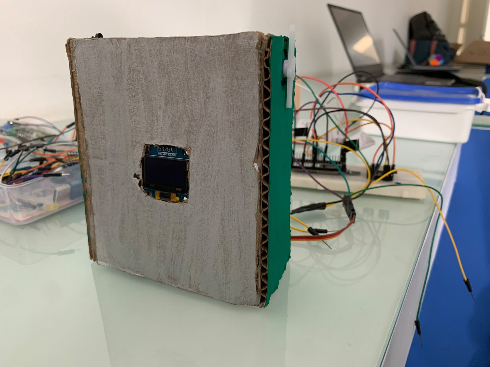
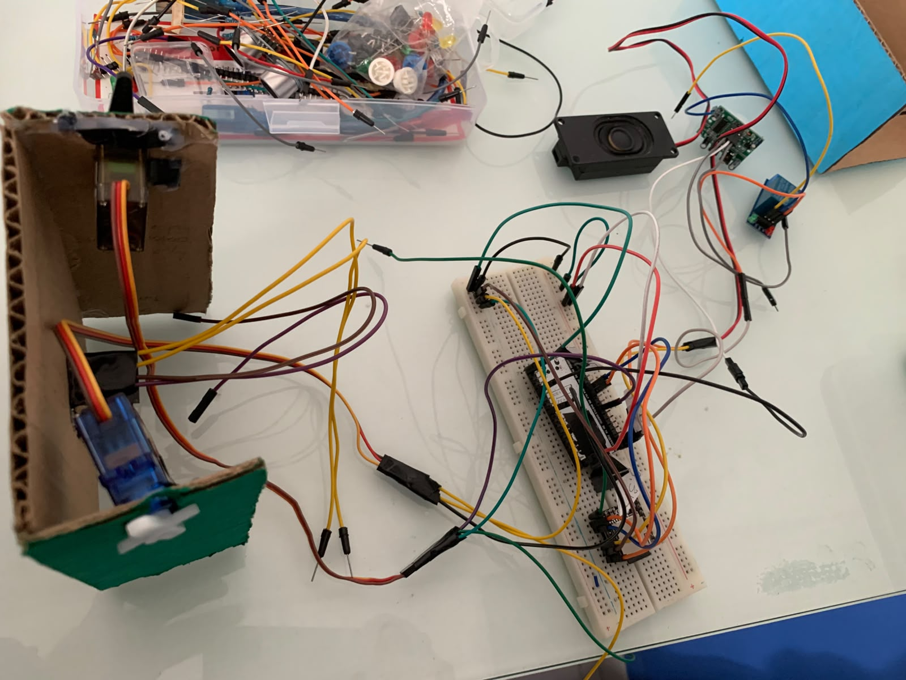

# AuraBot — Asistente Interactivo de Escritorio

**Semestre:** ago-dic-2026  
**Materia:** Sistemas Programables — ISC TecNM León  

## Integrantes

| Nombre | Matrícula | Rol | GitHub |
| :--- | :--- | :--- | :--- |
| Sandoval Cuevas Pedro | 23240325 | 🔧 Firmware ESP32 | [@Pedro384e](https://github.com/Pedro384e) |
| Taboada Ramírez Salvador | 23240999 | 🧠 Servidor Python / IA | [@salvador323](https://github.com/salvador323) |
| Barroso Garcia Braulio Axel | 23240327 | ☁️ Firebase / 🔩 Hardware | [@AxelCuber15](https://github.com/AxelCuber15) |

---

## 📌 Descripción General

AuraBot es un Sistema Inteligente de Monitoreo Ergonómico y Asistencia Cognitiva diseñado para la intervención temprana de estrés y malas posturas en entornos de trabajo remoto.

* **¿A quién ayuda?** A estudiantes universitarios de ingeniería y profesionales del sector tecnológico que enfrentan jornadas extensas frente al monitor en condiciones de aislamiento.
* **¿Qué problema resuelve?** Combate la incidencia de fatiga mental, estrés académico y episodios de ansiedad silenciosa, así como la disminución del rendimiento cognitivo por malas posturas y la falta de pausas activas.
* **¿Cómo lo resuelve de forma diferente a lo que ya existe?** Mediante *Edge Computing*. El sistema evalúa la biometría facial en memoria volátil (garantizando total privacidad sin subir fotos a la nube) y la postura física mediante sensores locales. Al detectar presencia o alteraciones, despliega un protocolo físico de *grounding*: activa iluminación ambiental mediante relevador, reproduce pistas auditivas guiadas y marca ritmos de respiración visuales en pantalla OLED y mecánicos mediante servomotores.

---

## 🏗️ Arquitectura del Sistema


### Tópicos MQTT

| Tópico | Dirección | Descripción |
| :--- | :--- | :--- |
| `aurabot/sensor/pir/central` | ESP32 → Broker | Lectura binaria de presencia (`0` / `1`) |
| `aurabot/sensor/ultrasonico/central` | ESP32 → Broker | Distancia del usuario al monitor en centímetros |
| `aurabot/sensor/luz/central` | ESP32 → Broker | Nivel de iluminación ambiental en porcentaje (`0-100%`) |
| `aurabot/sensor/camara/cam` | ESP32-CAM → Broker | Transmisión de frames de video en formato RGB565 (`160x120`) |
| `aurabot/comando/ia/escanear` | Broker → Servidor IA | Orden `"iniciar"` o `"detener"` para el escaneo facial |
| `aurabot/estado_actual/rostro` | Servidor IA → Broker | Publica el nombre del usuario identificado o `"Desconocido"` |
| `aurabot/comando/relevador/central` | Broker → ESP32 | Comando `"encender"` / `"apagar"` para iluminación ambiental |
| `aurabot/comando/servo/central` | Broker → ESP32 | Comando `"saludar"` / `"respirar"` / `"reposo"` para cabeza y brazos |
| `aurabot/comando/oled/central` | Broker → ESP32 | Comando `"feliz"` / `"neutral"` / `"apagada"` para pantalla OLED |
| `aurabot/comando/audio/central` | Broker → ESP32 | Número de pista MP3 (`1`, `2`, ...) o `"stop"` para DFPlayer Mini |

---

## 🛠️ Hardware

| # | Componente | Tipo | Cantidad | Costo aprox. MXN |
| :-: | :--- | :--- | :-: | :-: |
| 1 | ESP32 DevKit V1 | Microcontrolador | 1 | $120 |
| 2 | ESP32-CAM | Cámara / Visión | 1 | $130 |
| 3 | Sensor PIR (HC-SR501) | Sensor de movimiento | 1 | $45 |
| 4 | Ultrasónico (HC-SR04) | Sensor de distancia | 1 | $40 |
| 5 | Fotorresistencia (LDR) | Sensor analógico de luz | 1 | $15 |
| 6 | Servomotor SG90 (Cabeza y Brazos) | Actuador PWM | 3 | $165 |
| 7 | Pantalla OLED SSD1306 (0.96" I2C) | Actuador visual | 1 | $70 |
| 8 | Relevador 5V (1 Canal) | Actuador de potencia | 1 | $35 |
| 9 | Módulo DFPlayer Mini + Bocina | Actuador de audio (Componente estrella) | 1 | $85 |
| | **Total** | | | **$705 MXN (< $800 MXN)** |

### Diagrama de conexiones


---

## 💻 Software y Firmware

### Requisitos del servidor Python

```bash
pip install -r servidor/requirements.txt
```

### Cómo ejecutar el sistema completo

1. **Levantar el broker MQTT** (en una terminal aparte):
   ```bash
   mosquitto -v
   ```
2. **Cargar firmware en las placas ESP32:**
   * Configurar credenciales locales en `firmware/config.py` (basado en `firmware/config_ejemplo.py`).
   * Abrir **Thonny** → conectar la **ESP32 DevKit V1** → cargar `main.py`, `comunicacion.py`, `config.py` y la carpeta `hal/dispositivos.py`.
   * Cargar el firmware de cámara ubicado en `firmware/cam/` en la **ESP32-CAM**.
3. **Ejecutar los servicios del servidor Python:**
   ```bash
   cd servidor
   python ia/detector_rostro.py
   python firebase.py
   ```

### Librerías ESP32 (MicroPython — corren en la placa)

| Librería | Uso |
| :--- | :--- |
| `umqtt.simple` | Cliente MQTT para publicación de sensores y suscripción a comandos |
| `machine` | Control de pines `Pin`, `PWM` (servos), `ADC` (LDR), `I2C` (OLED) y `UART` (audio) |
| `network` | Gestión de conexión Wi-Fi en modo estación (`STA_IF`) |
| `ssd1306` | Controlador gráfico para expresiones faciales en pantalla OLED |
| `time` | Temporización no bloqueante (`ticks_ms`) y medición de pulsos (`time_pulse_us`) |

### Librerías servidor Python (corren en la PC)

| Librería | Versión | Uso |
| :--- | :--- | :--- |
| `paho-mqtt` | `>= 2.0.0` | Comunicación MQTT entre broker Mosquitto, IA y Firebase |
| `opencv-contrib-python` | `>= 4.8.0` | Decodificación de frames RGB565, detección DNN y reconocimiento LBPH |
| `numpy` | `>= 1.24.0` | Manipulación matricial de arreglos de imagen y conversión de color |
| `firebase-admin` | `>= 6.0.0` | Sincronización bidireccional con Firebase Realtime Database |

---

## 🧠 Inteligencia Artificial

* **Modelo:** Detector facial basado en redes neuronales profundas (**OpenCV DNN con arquitectura Caffe `res10_300x300_ssd`** y respaldo Haar Cascade) acoplado a un reconocedor facial **LBPH (*Local Binary Patterns Histograms*)** entrenado localmente (`modelo_rostro.yml`).
* **Qué detecta:** Detecta la presencia de rostros humanos frente al escritorio a partir de frames RGB565 (`160x120`) transmitidos por la ESP32-CAM y clasifica la identidad del usuario registrado.
* **Cómo toma decisiones:** El escaneo permanece en reposo hasta recibir la orden `"iniciar"` en `aurabot/comando/ia/escanear` (activada por proximidad). Al detectar un rostro, evalúa la distancia LBPH (`< 85`): si acumula **3 detecciones consecutivas válidas**, publica el nombre en `aurabot/estado_actual/rostro` y envía `"detener"` para liberar recursos; tras **8 intentos fallidos**, lo clasifica como `"Desconocido"` y detiene el escaneo.
* **Confianza mínima aceptada:** **60%** (`0.60`) para la detección espacial del rostro en DNN y distancia euclidiana `< 85` para la validación de identidad en LBPH.

---

## 🎥 Demostración

* **Video demostrativo (YouTube):** ▶️ [Ver video de funcionamiento en YouTube](https://www.youtube.com/) *(Actualizar enlace antes del PR final)*

### Fotos del prototipo final

| Vista frontal | Vista interna | Armado superior |
| :---: | :---: | :---: |
|  |  |  |

---

## 📋 HAL — Hardware Abstraction Layer

| # | Componente | Pin ESP32 | Tópico MQTT | Unidad | Rango válido |
| :-: | :--- | :--- | :--- | :--- | :--- |
| 1 | Sensor PIR (HC-SR501) | `GPIO 13` | `aurabot/sensor/pir/central` | Binario | `0` (sin movimiento) – `1` (presencia) |
| 2 | Ultrasónico (HC-SR04) | `TRIG: GPIO 25` / `ECHO: GPIO 26` | `aurabot/sensor/ultrasonico/central` | `cm` | `2.0 – 400.0 cm` (`-1` fuera de rango) |
| 3 | Fotorresistencia (LDR) | `GPIO 34` (ADC) | `aurabot/sensor/luz/central` | `%` | `0 – 100 %` |
| 4 | Relevador 5V (Luz ambiental) | `GPIO 23` | `aurabot/comando/relevador/central` | Estado | `"encender"` / `"apagar"` |
| 5 | Servomotor SG90 (Cabeza) | `GPIO 18` (PWM) | `aurabot/comando/servo/central` | Grados (`°`) | `70° – 110°` (`90°` reposo) |
| 6 | Servomotor SG90 (Brazo Izq.) | `GPIO 19` (PWM) | `aurabot/comando/servo/central` | Grados (`°`) | `20° – 130°` |
| 7 | Servomotor SG90 (Brazo Der.) | `GPIO 27` (PWM) | `aurabot/comando/servo/central` | Grados (`°`) | `50° – 160°` |
| 8 | Pantalla OLED SSD1306 (I2C) | `SCL: GPIO 22` / `SDA: GPIO 21` | `aurabot/comando/oled/central` | Expresión | `"feliz"` / `"neutral"` / `"apagada"` |
| 9 | DFPlayer Mini (UART 2) | `TX: GPIO 17` / `RX: GPIO 16` | `aurabot/comando/audio/central` | Pista / Cmd | `1 – 255` / `"stop"` |

---

## 🔥 Esquema Firebase

Estructura implementada en **Firebase Realtime Database** (`aurabot-4ba95-default-rtdb.firebaseio.com`):

```text
/
├── sensores/
│   └── telemetria/
│       ├── pir: 1
│       ├── distancia_cm: 45.2
│       └── luz_porcentaje: 68
├── actuadores/
│   ├── servomotor/
│   │   └── estado: "saludar"
│   ├── relevador/
│   │   └── estado: "apagar"
│   └── oled/
│       └── estado: "feliz"
├── presencia/
│   └── actual/
│       ├── usuario: "Pedro"
│       └── ultima_actualizacion: "2026-11-04 10:12:19"
├── estado_sistema/
│   └── nodo_central: "activo"
└── alertas/
    └── {push_id}/
        ├── evento: "Acceso detectado"
        ├── usuario: "Pedro"
        └── fecha_hora: "2026-11-04 10:12:19"
```

---

## ⚠️ Retos técnicos encontrados

1. **Transmisión y decodificación de video sobre MQTT:** Enviar imágenes comprimidas saturaba la memoria de la ESP32-CAM. Se resolvió transmitiendo frames crudos en formato RGB565 (`160x120`, 38,400 bytes) y reconstruyendo los canales BGR mediante operaciones a nivel de bits (`numpy`) en el servidor Python, activando la cámara únicamente cuando se detecta proximidad.
2. **Prevención de bucles infinitos entre Firebase y MQTT:** Al sincronizar los comandos de la interfaz web hacia los actuadores y viceversa, existía el riesgo de generar ciclos de publicación repetida. Se solucionó implementando un diccionario de control de estado previo (`ultimo_estado_actuador`) en `firebase.py` para publicar solo cuando existe un cambio real.
3. **Calibración mecánica simétrica de servomotores:** Debido a la orientación opuesta de los brazos en la carcasa, un mismo ángulo producía movimientos contrarios. Se implementaron funciones de abstracción en `dispositivos.py` (`reposo_servos`, `saludar_servos`, `respirar_servos`) con ángulos complementarios (`20°` vs `160°`) y retardos escalonados para evitar picos de corriente en la fuente de 5V.