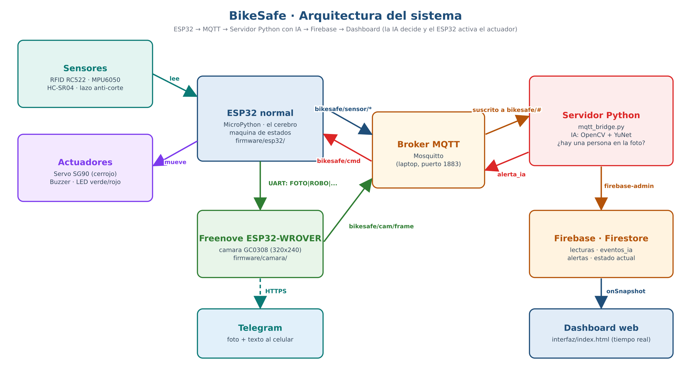
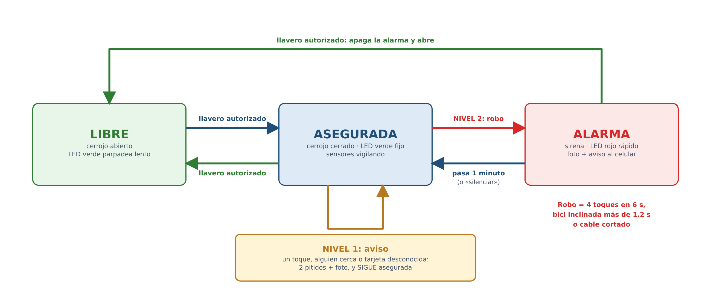
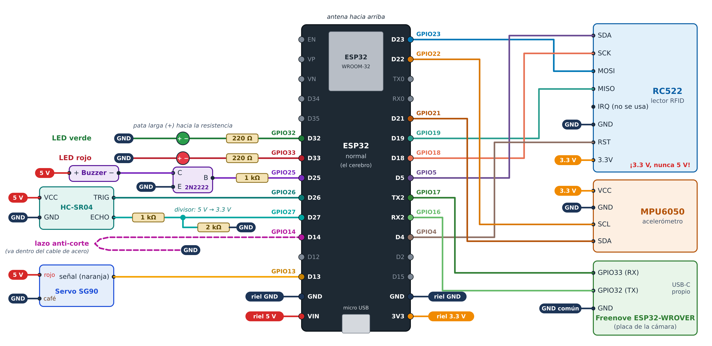
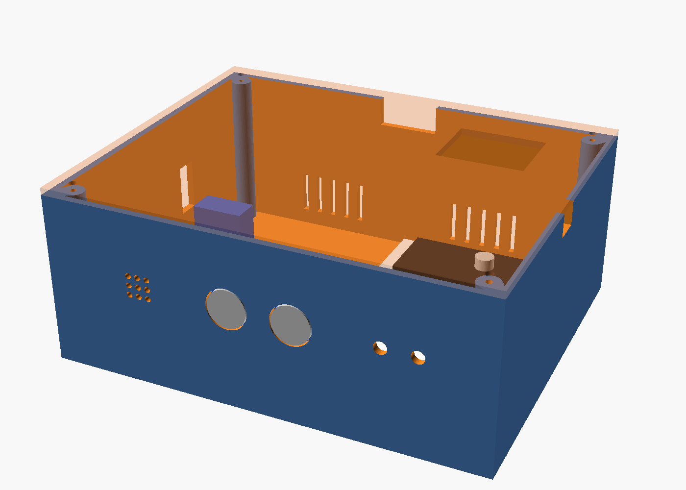
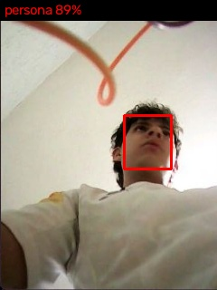
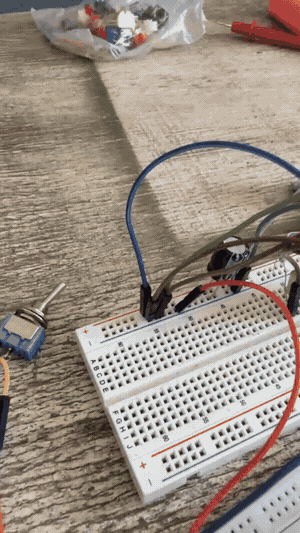
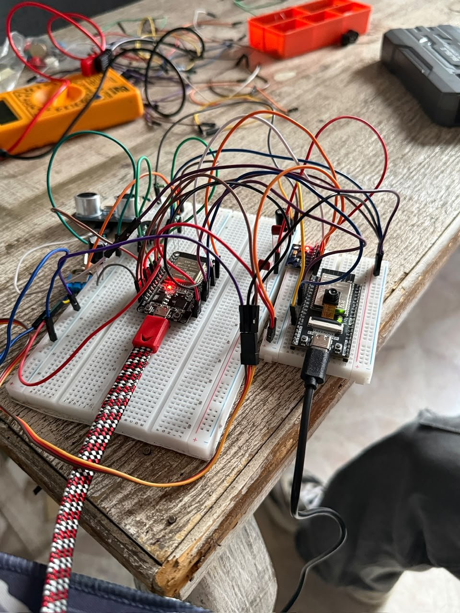
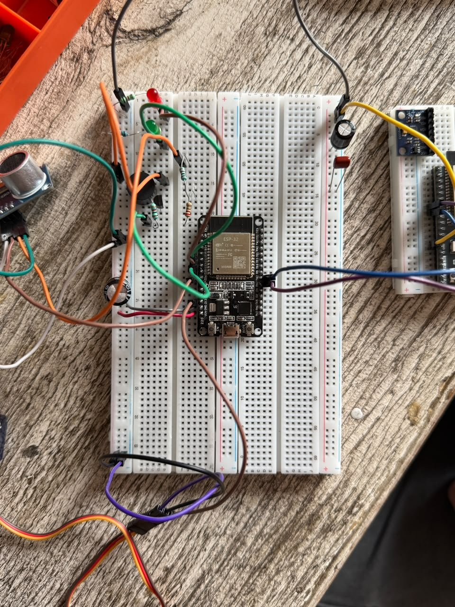
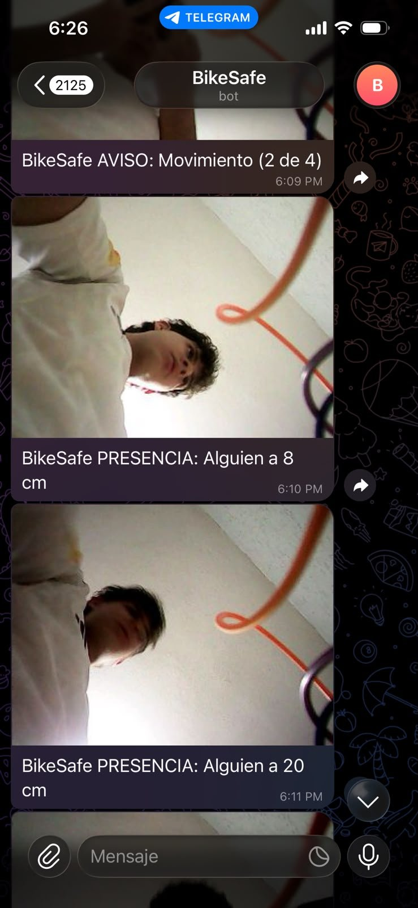
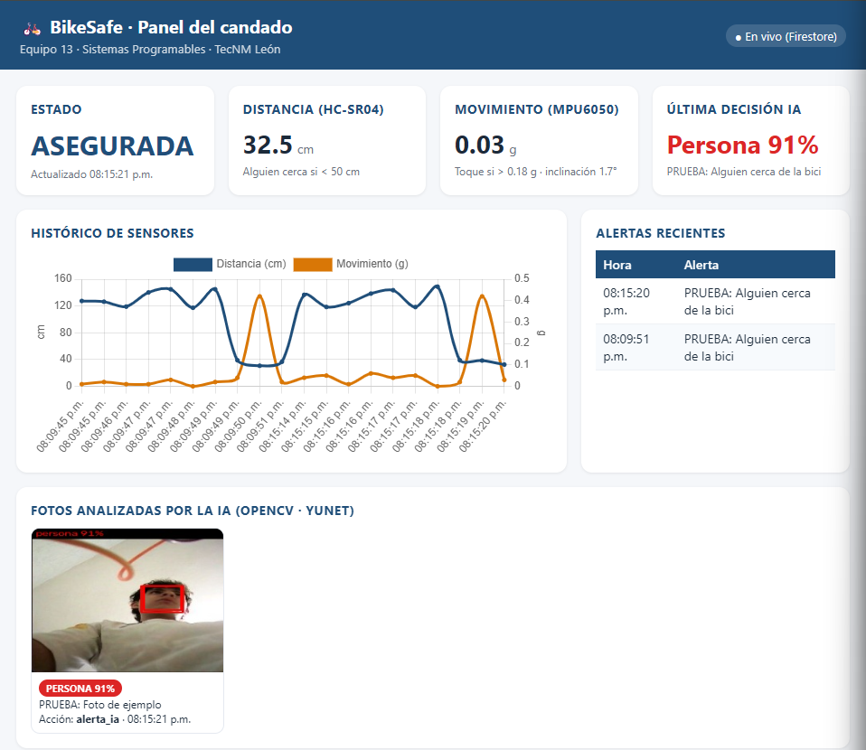

# BikeSafe — Candado inteligente portátil para bicicletas


> **Semestre:** ago-dic-2026
> **Materia:** Sistemas Programables — ISC TecNM León
> **Equipo:** 13 · Horario 10
> **Integrantes:**

| Nombre | Matrícula | Rol | GitHub |
|--------|-----------|-----|--------|
| Oscar Sandoval Cabrera | 23240457 | 🔧 Firmware ESP32 · 🧠 Servidor Python/IA · ☁️ Firebase/Interfaz | [@Sand027](https://github.com/Sand027) |
| Diego Josué Talamantes Santiago | 23240355 | 🔩 Hardware/Carcasa · 📝 Documentación | [@josuegoku2203-creator](https://github.com/josuegoku2203-creator) |

---

## 📌 Descripción General

- **¿A quién ayuda?** A estudiantes y trabajadores que se mueven en bicicleta y la dejan en bici-estacionamientos públicos (escuela, trabajo, centro), donde los robos son frecuentes y los candados comunes se cortan en segundos.
- **¿Qué problema resuelve?** Un candado normal no avisa: el dueño se entera del robo cuando regresa. BikeSafe vigila la bici, distingue un roce de un intento de robo, toma una foto del sospechoso y avisa al celular al instante.
- **¿Qué lo hace diferente?** Es un candado **portátil** (va en la mochila y sirve en cualquier estacionamiento), se abre con llavero **RFID**, tiene **alarma de dos niveles** (aviso / robo) para no sonar con cada roce, y usa **visión por computadora** para confirmar que hay una persona junto a la bici antes de escalar la alerta.

---

## 🏗️ Arquitectura del Sistema



Dos placas trabajan juntas:

- **ESP32 normal (el cerebro):** lee los sensores, decide el estado del candado (LIBRE → ASEGURADA → ALARMA) y mueve los actuadores. Publica todo por MQTT.
- **Freenove ESP32-WROVER (el fotógrafo):** recibe la orden `FOTO|nivel|motivo` por UART, toma la foto, la publica en `bikesafe/cam/frame` y la manda a Telegram.
- **Servidor Python (laptop):** recibe sensores y fotos por MQTT; la IA (OpenCV) decide si hay una persona y, si la hay, publica `alerta_ia` para que el ESP32 avise. Guarda todo en Firebase.
- **Dashboard web:** muestra en tiempo real el estado, la gráfica histórica, las alertas y las fotos analizadas.



### Tópicos MQTT

| Tópico | Dirección | Descripción |
|--------|-----------|-------------|
| `bikesafe/sensor/distancia` | ESP32 → Broker | Distancia del HC-SR04 (cm) |
| `bikesafe/sensor/movimiento` | ESP32 → Broker | Cambio de aceleración del MPU6050 (g) |
| `bikesafe/sensor/inclinacion` | ESP32 → Broker | Inclinación de la bici (°) |
| `bikesafe/sensor/lazo` | ESP32 → Broker | Lazo anti-corte: `ENTERO` / `CORTADO` |
| `bikesafe/sensores` | ESP32 → Broker | Las lecturas juntas en JSON (cada 2 s) |
| `bikesafe/estado` | ESP32 → Broker | `LIBRE` / `ASEGURADA` / `ALARMA` (retenido) |
| `bikesafe/alerta` | ESP32 → Broker | Texto de cada aviso o robo |
| `bikesafe/cam/info` | ESP32-CAM → Broker | `{"nivel", "motivo", "n"}` de la foto que sigue |
| `bikesafe/cam/frame` | ESP32-CAM → Broker | Frame de cámara (JPEG 320×240) |
| `bikesafe/ia/resultado` | Servidor → Broker | Decisión de la IA en JSON |
| `bikesafe/cmd` | Broker → ESP32 | `asegurar` · `liberar` · `silenciar` · `foto` · `alerta_ia` |
| `bikesafe/servo/cmd` | Broker → ESP32 | Actuador 1: `cerrar` / `abrir` |
| `bikesafe/buzzer/cmd` | Broker → ESP32 | Actuador 2: `pitido` / `sirena_off` |
| `bikesafe/led/cmd` | Broker → ESP32 | Actuador 3: `alerta` / `normal` |

---

## 🛠️ Hardware

| # | Componente | Tipo | Cant. | Costo MXN | Origen |
|---|-----------|------|------|-----------|--------|
| 1 | ESP32 DevKit (WROOM-32) | Microcontrolador | 1 | $120 | Kit ESP32 propio |
| 2 | Freenove ESP32-WROVER con cámara GC0308 | Cámara | 1 | $420 | Compra |
| 3 | Lector RFID RC522 + llavero | Sensor | 1 | $80 | Compra |
| 4 | Acelerómetro MPU6050 | Sensor | 1 | $60* | Préstamo de la maestra |
| 5 | Ultrasónico HC-SR04 | Sensor | 1 | $45* | Préstamo de la maestra |
| 6 | Lazo anti-corte (interruptor de palanca 2 patas) | Sensor | 1 | $15 | Compra |
| 7 | Servo SG90 (cerrojo) | Actuador | 1 | $50* | Préstamo de la maestra |
| 8 | Buzzer activo 5 V | Actuador | 1 | $5 | Compra |
| 9 | LED verde y rojo + resistencias 220 Ω, 1 kΩ, 2 kΩ | Actuador | 2 | $0 | Incluidos en el kit ESP32 |
| 10 | Capacitores 1000 µF ($15), 470 µF ($8), 2 cerámicos 104 ($4 c/u) | Energía | 4 | $31 | Compra |
| 11 | Carcasa impresa en 3D (PLA) | Estructura | 1 | $150 | Impresión con Gael |
| 12 | Cable de acero con candado (genérico) | Estructura | 1 | $120* | Por comprar |
| 13 | Powerbank USB | Energía | 1 | $0 | Propia |
| | **Gastado por el equipo** (2, 3, 6, 8, 10, 11) | | | **$701** | |
| | **Costo total del prototipo** (con kit, préstamos y candado) | | | **$1,096** | |

\* Precio de referencia en tiendas en línea de México. No lo pagamos: es préstamo o todavía no se compra.

> **Sobre el límite de $800:** lo que el equipo gastó ($701) entra en el presupuesto. El costo total del prototipo lo rebasa, sobre todo por la Freenove ($420). Elegimos la Freenove porque se programa directo por USB-C y trae PSRAM para manejar las fotos; la ESP32-CAM común es más barata, pero necesita una base programadora aparte.

### Diagrama de conexiones



| Más diagramas | |
|---|---|
| [Acomodo en la protoboard](hardware/acomodo-protoboard.png) | [Alimentación y rieles](hardware/energia.png) |
| [Diagrama de bloques](hardware/bloques.png) | [Máquina de estados](hardware/maquina-estados.png) |

> **Cambio respecto al diagrama:** el buzzer quedó conectado **directo a D25** (sin el transistor 2N2222), porque con el transistor no sonaba. Es un buzzer activo y consume poca corriente, así que funciona igual.


### Carcasa impresa en 3D



Caja de PETG para el prototipo en protoboard (181 × 146 × 75 mm armada), diseñada en OpenSCAD y paramétrica. Lleva la protoboard de 830 puntos al frente, la mini protoboard con la Freenove y el MPU6050 atrás, y el servo a la izquierda. Tiene orificios para el HC-SR04, los LEDs y el buzzer en la pared frontal, una ventana para la cámara en la tapa, ranuras para el USB, el lazo anti-corte y el pestillo, ventilación, y la tapa encaja con ceja y 4 tornillos.

| Archivo | Para qué |
|---|---|
| [`00_Probeta_tornillos.stl`](hardware/carcasa-3d/00_Probeta_tornillos.stl) | Prueba de agujeros de tornillo (2.3 / 2.5 / 2.7 mm) |
| [`01_Base_BikeSafe.stl`](hardware/carcasa-3d/01_Base_BikeSafe.stl) · [`02_Tapa_BikeSafe.stl`](hardware/carcasa-3d/02_Tapa_BikeSafe.stl) | Piezas a imprimir |
| [`BikeSafe_Carcasa.scad`](hardware/carcasa-3d/BikeSafe_Carcasa.scad) | Modelo editable (medidas en variables) |
| [`Plano_BikeSafe.pdf`](hardware/carcasa-3d/Plano_BikeSafe.pdf) | Ficha de impresión + plantilla 1:1 del interior |

---

## 💻 Software y Firmware

```
equipo-13-bikesafe/
├── firmware/
│   ├── esp32/        ← ESP32 normal: main.py, config.py, red.py, hal/, lib/mfrc522.py
│   ├── camara/       ← Freenove: main.py, config.py, telegram.py
│   └── pruebas/      ← una prueba por pieza (e02_servo.py … e11_lazo.py)
├── servidor/         ← mqtt_bridge.py, ia/detector.py, nube.py, requirements.txt
├── interfaz/         ← dashboard (index.html) + reglas de Firestore
├── hardware/         ← arquitectura, diagramas y carcasa-3d/ (STL + OpenSCAD)
├── media/            ← fotos del prototipo y evidencias
└── docs/             ← infografía y reporte
```

### Requisitos del servidor Python

```bash
pip install -r servidor/requirements.txt
```

### Cómo ejecutar el sistema completo

**1. Levantar el broker MQTT** (en una terminal aparte; Mosquitto debe aceptar conexiones de la red local):
```
mosquitto -v
```

**2. Cargar firmware en las placas (Thonny):**
- **ESP32 normal:** copiar `config.example.py` como `config.py` y llenarlo (WiFi, IP del broker). Subir `main.py`, `config.py`, `red.py` y las carpetas `hal/` y `lib/` de `firmware/esp32/`. En `config.py` poner el WiFi y en `MQTT_BROKER` la IP de la laptop.
- **Freenove:** copiar `config.example.py` como `config.py` y llenarlo (WiFi, broker, token de Telegram). Subir `main.py`, `config.py` y `telegram.py` de `firmware/camara/`. **Los `config.py` reales no se suben a GitHub** (están en `.gitignore`). Necesita MicroPython **con cámara** (`mpy_cam-…-ESP32_GENERIC-SPIRAM`). Llenar WiFi, `MQTT_BROKER`, `TELEGRAM_TOKEN` y `TELEGRAM_CHAT_ID`.
- Si al arrancar sale `MQTT: este firmware no trae umqtt`, instalarlo una vez desde la consola: `import mip; mip.install("umqtt.simple")`.

**3. Ejecutar el servidor de IA:**
```
cd servidor
python mqtt_bridge.py
```
Para probarlo sin las placas: `python simular_candado.py ../media/ia-deteccion-persona.jpg`.

**4. Abrir el dashboard:**
```
cd interfaz
python -m http.server 8000
```
y entrar a `http://localhost:8000` (con `?demo=1` muestra datos de ejemplo).

### Librerías ESP32 (MicroPython — corren en la placa)

| Librería | Uso |
|---------|-----|
| `umqtt.simple` | Cliente MQTT en la ESP32 y en la Freenove |
| `machine` | GPIO, PWM (servo, buzzer), I2C (MPU6050), SPI (RC522), UART (enlace entre placas) |
| `network` | Conexión WiFi |
| `camera` + `jpeg` | Cámara GC0308 y conversión del frame a JPEG (firmware `micropython-camera-API`) |
| `lib/mfrc522.py` | Driver del lector RFID (incluido en el repo) |

### Librerías servidor Python (corren en la PC)

| Librería | Versión | Uso |
|---------|---------|-----|
| paho-mqtt | ≥ 2.0 | Cliente MQTT en el servidor |
| opencv-python | ≥ 4.8 | Procesamiento de imagen e IA (YuNet + HOG) |
| numpy | ≥ 1.24 | Manejo de la imagen |
| firebase-admin | ≥ 6.0 | Escritura en Firestore |

---

## 🧠 Inteligencia Artificial

- **Modelo:** OpenCV — **YuNet** (red neuronal para caras, `servidor/ia/modelos/face_detection_yunet_2023mar.onnx`, 230 KB) + **HOG/SVM** de personas (cuerpo completo).
- **Qué detecta:** si en la foto del candado hay una **persona** junto a la bici. Como la cámara va de lado dentro del candado, la foto se analiza girada 0°, 90°, 180° y 270° y se toma el mejor resultado.
- **Cómo toma decisiones:** si detecta `persona` con confianza ≥ 60 % → publica `alerta_ia` en `bikesafe/cmd` → el ESP32 da 3 pitidos y prende el LED rojo 3 s. Siempre guarda la decisión (clase, confianza, acción y miniatura de la foto) en `eventos_ia` de Firebase.
- **Confianza mínima aceptada:** 60 % (`CONFIANZA_MINIMA` en `servidor/config.py`).

Prueba con una foto real de su cámara: **persona 89 %** en 138 ms.



---

## 🎥 Demostración

**Video demostrativo (YouTube):** _(pendiente — se sube con la carcasa terminada)_

Recorrido del circuito en protoboard:



### Fotos del prototipo

| Protoboard completa | Cerebro (ESP32) | Alertas en Telegram |
|--------------|---------------|----------------------|
|  |  |  |

> Las fotos con la **carcasa cerrada** (vista frontal, interna y en operación) se agregan en el Sprint 3.

---

## 📋 HAL — Hardware Abstraction Layer

| # | Componente | Pin ESP32 | Tópico MQTT | Unidad | Rango válido |
|---|-----------|-----------|-------------|--------|-------------|
| 1 | HC-SR04 (ultrasónico) | TRIG GPIO26 · ECHO GPIO27 (divisor 1 kΩ/2 kΩ) | `bikesafe/sensor/distancia` | cm | 2 – 400 (alerta < 50) |
| 2 | MPU6050 (acelerómetro) | I2C SDA GPIO21 · SCL GPIO22 | `bikesafe/sensor/movimiento` | g | 0 – 2 (toque > 0.18) |
| 2b | MPU6050 (inclinación) | I2C SDA GPIO21 · SCL GPIO22 | `bikesafe/sensor/inclinacion` | ° | 0 – 180 (robo > 25° por 1.2 s) |
| 3 | Lazo anti-corte | GPIO14 (pull-up interno) | `bikesafe/sensor/lazo` | — | `ENTERO` / `CORTADO` |
| 4 | Lector RFID RC522 | SPI: SDA GPIO5 · SCK GPIO18 · MOSI GPIO23 · MISO GPIO19 · RST GPIO4 | `bikesafe/alerta` / `bikesafe/estado` | UID | tarjetas de `TARJETAS_AUTORIZADAS` |
| 5 | Servo SG90 (cerrojo) | GPIO13 (PWM 50 Hz) | `bikesafe/servo/cmd` | ° | 0 (abierto) – 90 (cerrado) |
| 6 | Buzzer activo | GPIO25 | `bikesafe/buzzer/cmd` | — | `pitido` / `sirena_off` |
| 7 | LED verde / rojo | GPIO32 / GPIO33 (220 Ω) | `bikesafe/led/cmd` | — | `alerta` / `normal` |
| 8 | Freenove ESP32-WROVER (cámara GC0308) | Ver tabla de la Freenove ↓ | `bikesafe/cam/frame` | JPEG | 320 × 240 |

---

### Pines de la Freenove (placa de la cámara)

La Freenove es **otra ESP32** con su propio MicroPython. Sus pines se dividen en tres grupos:

| Grupo | Pines de la Freenove | Va a | Notas |
|------|----------------------|------|-------|
| **Enlace con la ESP32** (UART) | **GPIO33** = RX (recibe) | **TX2 / GPIO17** de la ESP32 | La ESP32 manda `FOTO\|nivel\|motivo` |
| | **GPIO32** = TX (envía) | **RX2 / GPIO16** de la ESP32 | La Freenove contesta `OK\|FOTO\|...` · 9600 baud |
| | **GND** | Riel GND de la protoboard | **Obligatorio:** sin GND común no se entienden |
| **Alimentación** | **USB-C** (5 V) | Powerbank | Con su propio cable; tomar 5 V del riel de la ESP32 no da corriente suficiente |
| **Cámara** (fijos en la placa, no se cablean) | D0–D7: 4, 5, 18, 19, 36, 39, 34, 35 · VSYNC 25 · HREF 23 · PCLK 22 · XCLK 21 (10 MHz) · SDA 26 · SCL 27 | Cable plano de la cámara | No conectar nada más en estos pines |

> Los cables van **cruzados**: lo que una placa envía (TX) lo recibe la otra (RX).

## 🔥 Esquema Firebase

Cloud Firestore. Solo el servidor escribe (llave de servicio). Para **leer**, el dashboard pide iniciar sesión con Google y las [reglas](interfaz/firestore.rules) solo permiten a las cuentas de los integrantes (por UID). Así las fotos de personas que analiza la IA **no son públicas**.

```
proyectos/bikesafe/
  lecturas/{timestamp}/
      distancia: 83.2
      movimiento: 0.02
      inclinacion: 1.4
      lazo: "ENTERO"
      estado: "ASEGURADA"
  eventos_ia/{timestamp}/
      deteccion: "persona"
      accion: "alerta_ia"
      confianza: 0.89
      modelo: "caras-yunet"
      nivel: "PRESENCIA"
      motivo: "Alguien a 30 cm"
      imagen: <JPEG 240×180 en base64>
  alertas/{timestamp}/
      texto: "AVISO: Movimiento (1 de 4)"
  estado/actual/
      estado: "ASEGURADA"
      distancia: 83.2
      ultima_ia: "persona"
      ultima_confianza: 0.89
```

Dashboard conectado a Firestore (proyecto `bikesafe-equipo13`) con datos de prueba de `servidor/probar_firebase.py`:



Si no está `servidor/serviceAccountKey.json`, el servidor guarda lo mismo en `servidor/registros/*.jsonl` (no se sube a GitHub).

---

## ⚠️ Retos técnicos encontrados

1. **La cámara GC0308 no genera JPEG por hardware.** La configuración en JPEG daba `ESP_ERR_NOT_SUPPORTED`. Se captura en RGB565 y se convierte con el módulo `jpeg`; solo funcionó con el formato `RGB565_BE` y el reloj de la cámara a 10 MHz. Las fotos quedan de 320×240.
2. **El servo no se movía aunque el código y la señal PWM estaban bien.** Con el multímetro se confirmó la señal en D13 y los 5 V en el riel; al final era un **jumper roto por dentro**. Al cambiar los 3 jumpers funcionó.
3. **El buzzer no sonaba con el transistor 2N2222.** Se conectó directo a D25 (buzzer activo de bajo consumo).
4. **Las pruebas corrían en la placa equivocada.** Con las dos placas conectadas, Thonny se conectaba a la Freenove (`SPIRAM` en el arranque) y no a la ESP32 normal (COM8).
5. **El programa anterior (carrito) ignoraba STOP y Ctrl+C.** Se reinstaló MicroPython con *Erase all flash*.
6. **La powerbank tiene una sola salida.** Alimentar la Freenove desde el riel de 5 V de la ESP32 no da corriente suficiente para cámara + WiFi; se requiere un cable USB "Y" o un hub.

---

## 🗓️ Avance por sprint

| Sprint | Entregable | Estado |
|--------|-----------|--------|
| 1 · HAL + MQTT | 4 sensores y 3 actuadores funcionando, tópicos MQTT, Tabla HAL | ✅ En protoboard (falta montar el RC522, en camino) |
| 2 · CAM + IA | Cámara publica frames, servidor con OpenCV decide y activa actuador | ✅ Código listo y probado con fotos reales de la cámara |
| 3 · Firebase + carcasa | Histórico en Firestore, dashboard, carcasa cerrada | 🟡 Firebase y dashboard funcionando · falta la carcasa |
| 4 · Final | Video, reporte PDF, fotos con carcasa | ⬜ Pendiente |

---

*Sistemas Programables · ISC TecNM León · ago-dic-2026*
