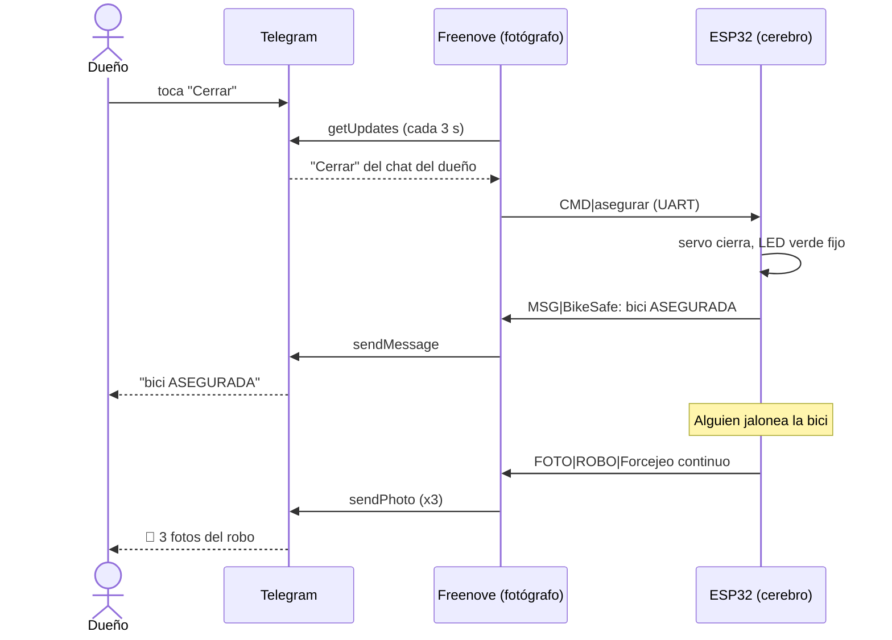

# 📱 Interfaz: bot de Telegram de BikeSafe

El dueño controla el candado con un **bot de Telegram**. No hace falta instalar una app propia: usa Telegram, que ya tiene en el celular.
El [dashboard web](index.html) es la otra interfaz: muestra el histórico de Firebase y lo que decidió la IA.

## Botones

```
[ Cerrar ]  [ Abrir  ]
[  Foto  ]  [ Estado ]
[ Buscar ]  [Silenciar]
```

| Botón | Respuesta del bot |
|---|---|
| Cerrar | "🔒 BikeSafe: bici ASEGURADA" (o "ya estaba asegurada"). Si el sensor magnético dice que el cable no está metido: "⛔ NO cerré…" |
| Abrir | "¿Seguro que quieres ABRIR el candado?" con los botones **Sí, abrir** / **No**. La confirmación dura 30 s. |
| Foto | 📷 Foto de ese momento |
| Estado | Resumen: estado, cerrojo (reed), cable, distancia, inclinación, última IA, conexión del dashboard, avisos, robos y tiempo encendido |
| Buscar | "Sonando 5 segundos para que la encuentres" |
| Silenciar | "Alarma silenciada, la bici sigue asegurada" |

También acepta los comandos **escritos**, con o sin "/" y en mayúsculas o minúsculas (`cerrar`, `/Cerrar`, `CERRAR`).

## Alertas que llegan solas

| Emoji | Alerta | Cuándo |
|---|---|---|
| ⚠️ | AVISO: Movimiento (1 de 4) | Un toque a la bici |
| 👀 | PRESENCIA: Alguien a 20 cm | Alguien parado junto a la bici |
| 🚨 | ROBO: Forcejeo continuo / Bici inclinada / Cable cortado | Intento de robo (3 fotos) |
| 🤖 | La IA confirmó una PERSONA junto a tu bici (58 %) | El servidor informó "persona" y **la ESP32 decidió** que es aviso (con 2 personas y la bici movida pasa a ROBO) |
| 🔓 | bici LIBERADA (desde dashboard) | Alguien del equipo abrió desde el dashboard |
| ⚠️ | Alguien más (chat 123) intentó usar tu bot | Un extraño le escribió al bot (se avisa una vez por chat) |

## Cómo funciona por dentro



**Protocolo UART** entre placas (texto, un renglón por mensaje, 9600 baudios):

| Dirección | Mensaje | Significado |
|---|---|---|
| ESP32 → Freenove | `FOTO\|nivel\|motivo` | Tomar foto y mandarla |
| ESP32 → Freenove | `MSG\|texto` | Mandar texto (`~` = salto de línea) |
| Freenove → ESP32 | `CMD\|asegurar` / `liberar` / `silenciar` / `estado` / `buscar` | Botón del bot |
| Freenove → ESP32 | `OK\|...` / `ERR\|...` | Resultado de cada orden |

## Seguridad

- Solo se obedecen los mensajes del `TELEGRAM_CHAT_ID` configurado, y si un extraño escribe, se le avisa al dueño.
- "Abrir" siempre pide confirmación.
- El token y la contraseña del WiFi **no están en este repositorio**.
