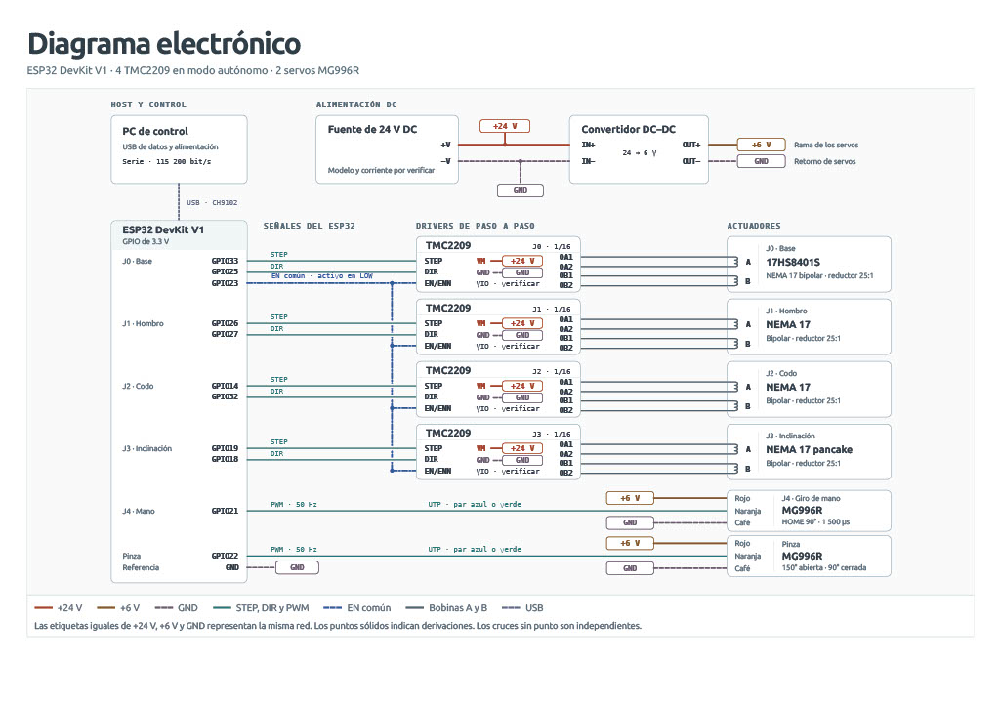

# MARC5 — Manipulador 5 ejes 

Semestre: ago-dic-2026 Materia: Sistemas Programables — ISC TecNM León 

Integrantes:
| Nombre | Matrícula | Rol | GitHub |
|--------|-----------|-----|--------|
| Silva Sánchez Enrique | 23240035 | 🔧 Firmware ESP32 & 🔩 Hardware | @usuario |
| Hernández Hernández José Manuel | 23240073 | ☁️ Interfaz Móvil & 🧠 Servidor Python/MQTT | @Punisher |
| Sepúlveda Becerra Frida Paulina | 23240043 | 📝 Documentación & Git | @Frida-Sepulveda |

---

📌 Descripción General

    ¿A quién ayuda este proyecto? A los operadores industriales, así como a pequeñas y grandes empresas que buscan mejorar sus procesos sin la necesidad de automatizar todo por completo.

    ¿Qué problema resuelve? Mitiga los riesgos físicos derivados de accidentes, tareas repetitivas y largas jornadas laborales que afectan la salud del trabajador.

    ¿Cómo lo resuelve de forma diferente a lo que ya existe? Protege al trabajador integrando un brazo robótico seguro que no depende de sensores de final de carrera externos, ya que utiliza la detección electromagnética StallGuard. Además, combina visión artificial de bajo consumo, un gemelo digital en ROS 2 y un flujo IoT completo para conservar el criterio humano en la operación.

🏗️ Arquitectura del Sistema
    

Tópicos MQTT (PENDIENTE)

🛠️ Hardware
| # | Componente | Tipo | Cantidad | Costo aprox. MXN |
|---|-----------|------|----------|-----------------|
| 1 | ESP32 DevKit | Microcontrolador | 1 | $120 |
| 2 | ESP32-CAM | Cámara | 1 | $450 |
| 3 | Motor NEMA 17 (17HS8401S) | Actuador | 3 | 495 |
| 4 | Motor NEMA 17 (17HS4023 Pancake) | Actuador | 1 | 165 |
| 5 | Driver TMC2209 | Control | 5 | 250 |
| 6 | Servo MG996R | Actuador | 2 | 150 |
| 7 | Reductores planetarios (25:1) | Mecánico | 4 | 80 Impreso en 3D|
| **Total** | | | | **$1710 MXN** |

---

Diagrama de conexiones

💻 Software y Firmware (PENDIENTE)

🧠 Inteligencia Artificial
% Modelo: YOLO26n.pt (versión nano) con OpenCV 5.0.0.
% Qué detecta: Elementos clave / objetos en el espacio de trabajo del manipulador.
% Cómo toma decisiones: Si la IA detecta el objeto objetivo y clasifica su posición, el servidor Python calcula y publica el comando (marc5/ejes/cmd y marc5/pinza/cmd) para que la ESP32 oriente el brazo y cierre la pinza.
% Confianza mínima aceptada: 50%

🎥 Demostración (PENDIENTE)

📋 HAL — Hardware Abstraction Layer
| # | Componente | Pin ESP32 | Tópico MQTT | Unidad | Rango válido |
|---|-----------|-----------|-------------|--------|-------------|
| 1 | Motor NEMA 17 (J0 Base) | GPIO33 (STEP), GPIO25 (DIR) | marc5/actuador1/cmd | Pasos /° | 0 a 360 |
| 2 | Motor NEMA 17 (J1 Hombro) | GPIO26 (STEP), GPIO27 (DIR) | marc5/actuador2/cmd | Pasos /° | 0 a 360 |
| 3 | Motor NEMA 17 (J2 Codo) | GPIO14 (STEP), GPIO32 (DIR) | marc5/actuador3/cmd | Pasos /° | 0 a 360 |
| 4 | Motor NEMA 17 (J3 Incl.) | GPIO19 (STEP), GPIO18 (DIR) | marc5/actuador4/cmd | Pasos /° | 0 a 360 |
| 5 | Servo MG996R (J4 Mano) | GPIO21 (PWM) | marc5/actuador5/cmd | ° | 0 a 180 |
| 6 | Servo MG996R (Pinza) | GPIO22 (PWM) | marc5/actuador6/cmd | ° | 0 a 180 |
| 7 | Habilitador Drivers (ENN) | GPIO23 | marc5/actuador7/cmd | Nivel | LOW/HIGH |
| 8 | ESP32-CAM | Interno | marc5/cam/frame | JPEG | Frame |

---

🔥 Esquema Firebase (PENDIENTES)

⚠️ Retos técnicos encontrados 