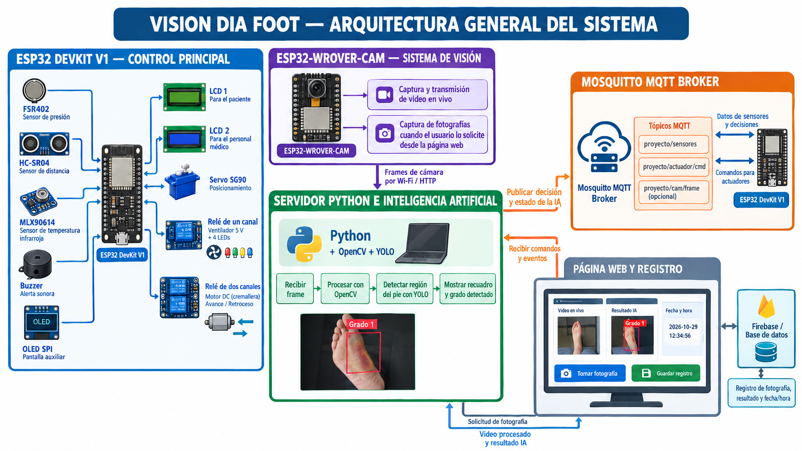
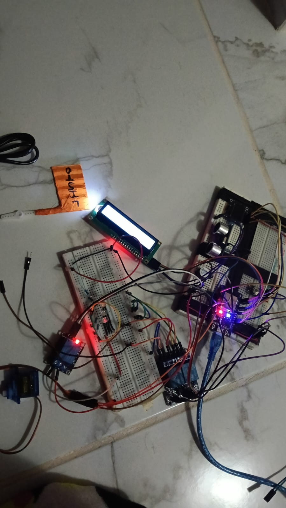

# [PIE DIABETICO - DIA FOOD]


> **Semestre:** ago-dic-2026
> **Materia:** Sistemas Programables — ISC TecNM León
> **Integrantes:**

| Nombre | Matrícula | Rol | GitHub |
|--------|-----------|-----|--------|
| GEOVANNI MORENO GOMEZ | 23240475 | Firmware ESP32/WROVER, Servidor Python/IA | @GeovanniMoreno |
| DANNA VALERIA ANGELES PEREZ | 23240335 | Hardware/Carcasa, Documentación | @Danna-noob |
| ANDREA LOPEZ ESTRADA | 23240168 | Carcasa | pendiente |

---

## 📌 Descripción General

Vision Dia Foot es un prototipo de estación automatizada diseñado para apoyar a personal médico y profesionales capacitados en la revisión preventiva del pie diabético. Busca identificar posibles señales de riesgo, como alteraciones de temperatura, presión y lesiones visibles, que pueden pasar desapercibidas en personas con neuropatía periférica.

El sistema integra sensores físicos, una cámara y un modelo de inteligencia artificial para analizar el pie y presentar información al personal médico y al paciente. Su propósito es apoyar la evaluación y facilitar la detección temprana de posibles problemas, sin sustituir un diagnóstico médico ni las pruebas clínicas necesarias para diagnosticar diabetes.

---

## 🏗️ Arquitectura del Sistema

> 📌 **Inserta aquí tu diagrama de arquitectura como imagen.**




## Transmisión de fotogramas — ESP32-WROVER-CAM

La ESP32-CAM funciona como un servidor HTTP local que captura fotogramas mediante la cámara integrada. Las imágenes se obtienen a través del endpoint/frame, utilizando el protocolo HTTP sobre la conexión Wi-Fi.

Los fotogramas se transmiten en formato RGB565 y son recibidos por el servidor Python de la laptop mediante solicitudes HTTP. Posteriormente, el programa vision_mqtt.py convierte los datos al formato de imagen BGR utilizado por OpenCV y realiza el procesamiento correspondiente mediante el modelo YOLO.

La comunicación se distribuye de la siguiente manera:
    HTTP: transmisión de fotogramas desde la ESP32-WROVER-CAM hacia la laptop.
    MQTT: intercambio de lecturas de sensores, estados del sistema, comandos para actuadores y resultados de la inteligencia artificial.

Esta separación permite utilizar HTTP para la transferencia de imágenes y MQTT para la comunicación de control y supervisión del sistema.


### Tópicos MQTT

| Tópico | Publica | Recibe |
|--------|-----------|-------------|
| `proyecto/sensores/lectura` | ESP32 DevKit | Laptop |
| `proyecto/actuador/estado` | ESP32 DevKit | Laptop |
| `proyecto/actuador/cmd` | Laptop | ESP32 DevKit |
| `proyecto/ia/decision` | Laptop | ESP32 DevKit |
| `proyecto/camara/estado` | Laptop | ESP32 DevKit |
| `proyecto/camara/cmd` | Dashboard futuro | Laptop |


---

## 🛠️ Hardware
> Se agrega únicamente la lista de componentes que se compraron durante el curso, porque ya contabamos con el resto de material 

| # | Componente | Tipo | Cantidad | Costo MXN |
|---|-----------|------|----------|-----------------|
| 1 | Cargador de 5V | NA | 1 | $80 |
| 2 | ESP 32 | Microcontrolador | 1 | $170 |
| 3 | ESP 32 WROVER | Microcontrolador | 1 | $286 |
| 4 | Pantalla OLED | Actuador | 1 | $120 |
| 5 | Módulo Relevador de 2 canales | Actuador | 1 | $55 |
| 6 | Sensor de fuerza/presión | Sensor | 1 | $225 |
| 7 | Sensor infrarrojo de temperatura | Sensor | 1 | $220 |
| **Total** | | | | **< $1,156 MXN** |

### Diagrama de conexiones



---

## 💻 Software y Firmware

### Requisitos del servidor Python

```bash
pip install -r servidor/requirements.txt
```

### Cómo ejecutar el sistema completo

**1. Levantar el broker MQTT** (en una terminal aparte):
```
mosquitto
```

**2. Conectar y cargar el firmware de la ESP32:**
```
Abrir Thonny, conectar la ESP32 y cargar los archivos correspondientes desde la carpeta firmware/.
```

**3. Iniciar la cámara:**
```
Encender la ESP32-WROVER-CAM y verificar que esté conectada a la red Wi-Fi y que el servidor pueda acceder a su dirección IP mediante HTTP.
```

**4. Ejecutar el servidor de procesamiento:**
```
Desde la carpeta correspondiente al servidor:

cd servidor
vision_mqtt.py
```

### Librerías ESP32 (MicroPython — corren en la placa)

| Librería | Uso |
|---------|-----|
| `machine` | Control de pines GPIO, ADC y PWM |
| `network` | Conexión Wi-Fi |
| `umqtt.simple` | Comunicación MQTT |
| `time` | Temporización y pausas |
| `I2C / SPI de machine` | Comunicación con pantallas y sensores |

### Librerías servidor Python (corren en la PC)

| Librería | Uso |
|---------|-----|
| paho-mqtt | Cliente MQTT en el servidor |
| opencv-python | Procesamiento de imagenes y video |
| ultralytics | Ejecución del modelo YOLO |
| numpy | Operaciones y conversión de imágenes |
| requests | Solicitudes HTTP, si se utiliza para obtener los fotogramas |
| firebase-admin | Integración con Firebase, si se implementa |
---

## 🧠 Inteligencia Artificial

- **Modelo:** YOLO, mediante la librería Ultralytics.
- **Qué detecta:** El modelo está configurado para identificar y clasificar imágenes relacionadas con diferentes grados de lesiones del pie diabético.
- **Cómo toma decisiones:** 
```
1.La ESP32-WROVER-CAM captura imágenes del área de revisión.
2.Los fotogramas llegan al servidor Python mediante HTTP.
3.OpenCV prepara las imágenes para su procesamiento.
4.YOLO analiza la imagen y genera las detecciones correspondientes.
5.El servidor obtiene la clase detectada y su nivel de confianza.
6.El resultado puede utilizarse para mostrar información en la interfaz y generar eventos o comandos para el sistema.
```
- **Confianza mínima aceptada:** _%_

---

## 🎥 Demostración
>El video aun no está disponible, quedará listo hasta el Sprint 4
**Video demostrativo (YouTube):** [▶️ Ver video](https://youtube.com/watch?v=XXXXXXXX)

### Fotos del prototipo final

| Vista frontal | Vista interna | Sistema en operación |
|--------------|---------------|----------------------|
|  |  |  |

---

## 📋 HAL — Hardware Abstraction Layer

| # | Componente | Pin ESP32 | Tópico MQTT | Unidad | Rango válido |
|---|-----------|-----------|-------------|--------|-------------|
| 1 | Sensor FSR402 | GPIO 34 | proyecto/s1 | ADC/presión relativa | 0-4096 |
| 2 | Sensor HC-SR04 | GPIO 14 y GPIO 35 | proyecto/s2 | cm | Aprox. 2 - 45cm|
| 3 | Sensor MLX90614 | GPIO 21 y 22 | proyecto/s3 | °C | Proporcionado por la fundación |
| 4 | Actuador 1: buzzer | GPIO 25 | proyecto/a1/cmd | ON/OFF | ON, OFF |
| 5 | Actuador 2: servo SG90 | GPIO 13 | proyecto/a2/cmd | grados | 0-180° |
| 6 | Actuador 3: relevador de 2 canales | GPIO 32 y 33 | proyecto/a3/cmd | dirección | avanzar, retroceder, parar |
| 7 | Actuador 4: relevador de 1 canal | GPIO 26 | proyecto/a4/cmd | ON/OFF | ON, OFF |
| 8 | Actuador 5: pantalla OLED | GPIO 21 y 22 | no aplica directamente | texto | estado |
| 9 | Actuador 6: pantalla LCD | GPIO 18, 23, 4 y 2 | no aplica directamente | texto | estado |
---

## 🔥 Esquema Firebase

```
/nombre-proyecto/
  /lecturas/{timestamp}/
      sensor1: valor
      sensor2: valor
      sensor3: valor
  /eventos_ia/{timestamp}/
      deteccion: "clase"
      accion: "actuador_ON"
      confianza: 0.92
  /estado_actual/
      sensor1: ultimo_valor
      actuador1: "ON"
```

---

## ⚠️ Retos técnicos encontrados

_(Llenar al finalizar el proyecto — esta sección alimenta las conclusiones del reporte)_

1.Transmisión de video: se presentaron problemas de fluidez y pixelación durante la recepción de imágenes de la ESP32-WROVER-CAM en el servidor Python.

2.Validación del modelo de IA: las métricas de validación de YOLO fueron bajas, por lo que sus resultados deben interpretarse con precaución.

3.Pruebas del prototipo: hubo varios falsos al conectar los componentes con jumpers, además de que se dificulto el acodomodo físico en el prototipo.

---

*Sistemas Programables · ISC TecNM León · ago-dic-2026*
