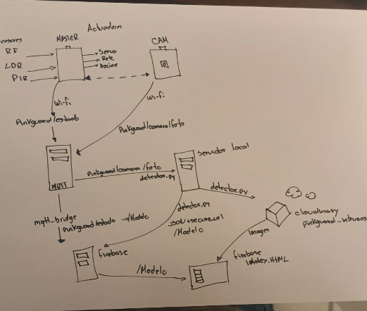
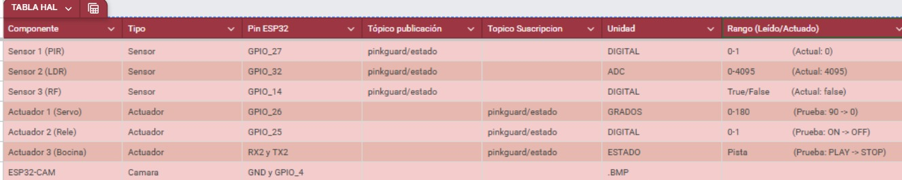

# PinkGuard


> **Semestre:** ago-dic-2026 **Materia:** Sistemas Programables — ISC TecNM León **Integrantes:**

| Nombre | Matrícula | Rol | GitHub |
| :---: | :---: | :---: | :---: |
| Montoya Chávez Angel Eduardo | 23240996  | Firmware ESP32, Servidor IA       | @pinkCClaws |
| Ríos López Jeremhy Damián    | 23240997  | Firebase, Interfaz, Documentación |  |
| Torres Romero Yoscar Yemmen  | 23240997  | Hardware                          |  |

## 📌 Descripción General

- **¿A quién ayuda este proyecto?:** A los transeuntes que tengan necesidad de pasar por una calle que 
suele estar sola o sitios públicos con puntos ciegos.
- **¿Qué problema resuelve?:** Resuelve uno de los factores claves que pueden volver a alguien una victima
de delitos, ser una persona aislada y dificil de ayudar.
- **¿Cómo lo resuelve de forma diferente a lo que ya existe?:** No solo permite tener un registro de lo que paso
si no alertar a las personas cercanas a la zona y disuadir a los delincuentes de no actuar debido a la vigilancia.

## 🏗️ Arquitectura del Sistema



## Tópicos MQTT

| Tópico | Dirección | Descripción |
| :--- | :---: | :--- |
| `pinkguard/estado` | ESP32 Master → Broker | Trama consolidada de telemetría y actuadores (`Trig\|PIR\|LDR\|RF\|Rele\|Servo`) enviada al detectar movimiento o cancelar alerta. |
| `pinkguard/estado` | Broker → `mqtt_bridge.py` | Consumo de eventos de estado para parseo a JSON y registro en tiempo real en Firebase RTDB (`/Modelo`). |
| `pinkguard/camara/foto` | ESP32-CAM → Broker | Transmisión asíncrona en bytes crudos de la captura fotográfica en formato BMP de 24 bits (`160x120 px`). |
| `pinkguard/camara/foto` | Broker → `detector.py` | Recepción del buffer de imagen para inferencia de personas con YOLOv8 Nano y subida de evidencia a Cloudinary. |

## 🛠️ Hardware

| # | Componente | Tipo | Cantidad | Costo aprox. MXN |
| :---: | :--- | :---: | :---: | :---: |
| 1 | ESP32 DevKit | Microcontrolador | 1 | $120 |
| 2 | ESP32-CAM (OV2640) | Cámara | 1 | $130 |
| 3 | Sensor PIR HC-SR501 | Sensor | 1 | $40 |
| 4 | Fotorresistencia LDR (GL5516) | Sensor | 1 | $10 |
| 5 | Módulo Receptor RF 433 MHz | Sensor | 1 | $35 |
| 6 | Servomotor SG90 (180°) | Actuador | 1 | $55 |
| 7 | Módulo Relevador 1 Canal 5V + Foco | Actuador | 1 | $65 |
| 8 | Bocina 3W + MicroSD (Audio) | Actuador | 1 | $45 |
| 9 | Módulo Reproductor MP3 DFPlayer Mini | No convencional | 1 | $45 |
| **Total** | | | | **$545 MXN (< $800 MXN)** |

### Diagrama de conexiones


## 💻 Software y Firmware

### Requisitos del servidor Python

```bash
pip install -r servidor/requirements.txt

```

### Como ejecutar el sistema completo:

Cargar firmware en los ESP32: Abrir Thonny → conectar el ESP32 Master y cargar firmware/main.py junto con la carpeta firmware/hal/; repetir el proceso con el ESP32-CAM cargando los archivos de firmware/cam/.

Levantar el servidor local (Mosquitto, puente Firebase e IA YOLOv8): Ejecutar el script automatizado en Windows:

```cmd
cd servidor
arrancar_servicios.bat
```


### Librerías ESP32 (MicroPython — corren en la placa)

| Librería | Uso |
| :--- | :--- |
| `umqtt.simple` | Cliente MQTT en el ESP32 Master y ESP32-CAM |
| `machine` | Control de pines GPIO, PWM (servomotor), ADC (LDR) y UART (DFPlayer) |
| `network` | Conexión WiFi en modo estación (`STA_IF`) |
| `camera` | Inicialización y captura de frames OV2640 en el ESP32-CAM |
| `dfplayer` | Control serial del reproductor MP3 DFPlayer Mini |
| `_thread` | Publicación asíncrona multihilo de imágenes desde el ESP32-CAM |
| `struct` / `time` | Empaquetado binario BMP de 24 bits y temporización no bloqueante |

### Librerías servidor Python (corren en la PC)

| Librería | Versión | Uso |
| :--- | :---: | :--- |
| `paho-mqtt` | ≥ 2.0 | Cliente MQTT suscrito a `pinkguard/estado` y `pinkguard/camara/foto` |
| `opencv-python` | ≥ 4.9 | Decodificación de bytes BMP, redimensionamiento (`320x240`) y guardado local |
| `firebase-admin` | ≥ 6.5 | Escritura en tiempo real en Firebase Realtime Database (`/Modelo`) |
| `ultralytics` | ≥ 8.2 | Inferencia de visión artificial con modelo **YOLOv8 Nano (`yolov8n.pt`)** |
| `cloudinary` | ≥ 1.40 | Subida de evidencias visuales a la nube y obtención de `secure_url` |
| `numpy` | ≥ 1.26 | Conversión de buffers crudos recibidos por MQTT a matrices de imagen |


## 🧠 Inteligencia Artificial

* **Modelo:** YOLOv8 Nano (`yolov8n.pt` mediante la librería `ultralytics`) + `OpenCV` para decodificación y preprocesamiento de buffers BMP.
* **Qué detecta:** Detección de objetos filtrada exclusivamente a la **clase `0` (`person`)** del dataset COCO sobre las capturas enviadas por el ESP32-CAM (`160x120 px`).
* **Cómo toma decisiones:** Al recibir una imagen en el tópico `pinkguard/camara/foto`, ejecuta la inferencia; **si detecta 1 o más personas** (`len(boxes) > 0`), dibuja los cuadros delimitadores (*bounding boxes*), etiqueta el evento como `INTRUSION_DETECTADA` (`humano_detectado: true`), sube la evidencia escalada (`320x240 px`) a Cloudinary y registra la alerta en Firebase RTDB (`/Modelo`). **Si no hay personas**, sube la imagen original y la registra como `MONITOREO_GENERAL` (`humano_detectado: false`).
* **Confianza mínima aceptada:** `40%` (`conf=0.4`).

## 🎥 Demostración

**Video demostrativo (YouTube):** [▶️ Ver video](https://www.youtube.com/watch?v=TU_ENLACE_AQUI)

### Fotos del prototipo final

| Vista frontal | Vista interna | Sistema en operación |
| :---: | :---: | :---: |
|  |  |  |

## 📋 HAL — Hardware Abstraction Layer



## 🔥 Esquema Firebase

```text
/Modelo/
    /{push_id_telemetria}/
        /sensores/
            Trig: "PIR_DETECCION" | "RF_CANCEL"
            PIR: 0 | 1
            LDR: 0..4095
            RF: 0 | 1
            Rele: true | false
            Servo: 0 | 45 | 90 | 135 | 180
        timestamp: 1732333508120
    /{push_id_evento_ia}/
        evento: "INTRUSION_DETECTADA" | "MONITOREO_GENERAL"
        humano_detectado: true | false
        imagen_url: "[https://res.cloudinary.com/.../pinkguard_intrusos/intruso.jpg](https://res.cloudinary.com/.../pinkguard_intrusos/intruso.jpg)"
        timestamp: 1732333510450
```

## ⚠️ Retos técnicos encontrados

1. **Captura de imagenes debido al modelo del ESP:** El firmware de MicroPython para la cámara OV2640 entrega capturas crudas (`RGB565`) que exceden los límites de memoria al codificarse o enviarse de forma síncrona. Se resolvió configurando resolución QQVGA (`160x120 px`), construyendo un empaquetador ligero a formato BMP de 24 bits con `struct` y delegando la publicación en el tópico `pinkguard/camara/foto` a un hilo secundario (`_thread`).
2. **Subida rápida de imágenes sin bloquear otras operaciones:** Debido al peso de las imágenes y la limitación de Procesamiento del propio ESP, subir una imágen a firebase por medio de WiFi bloqueaba otras operaciones, por lo que se delego el envio a un servidor MQTT intermediario ya que este protocolo permite reducir la carga en el ESP.
3. **Sincronización de los sensores con la cámara:** La captura de las imágenes se da con un ESP ajeno a las lecturas de los sensores, por lo que fue necesario un activador entre ambos ESP, en el que uno solicitaba la foto en base a las lecturas y el otro al recibir el aviso las toma y delega su envio a un hilo conectado al servidor.
4. **Detección de presencia con un solo PIR:** Detectar la presencia en multiples angulos con un solo pir estático fue imposible, por lo que lo unimos al servomotor que gira la cámara para estimar donde se debe tomar la foto en un ciclo de movimiento.
5. **Posteo en firebase sin bloquear al ESP:** EL posteo de datos e imágenes en Firebase frena otras operaciones debido a la latencia en el wifi, e incluso la gestión de datos no subidos incrementa la dificultad en los ESP, por lo que se le delego estar tarea a un escucha en el servidor MQTT que se encarga únicamente en subir la información a su tópico correspondiente.
6. **Almacenamiento de imágenes fuera de firebase:** La prueba gratuita de Firebase estaba limitada en cuanto a Almacenamiento por lo que subir imágenes era imposible, decidimos usar una nube externa para la subida de imágenes, haciendo que firebase solo almacenara la URL de las mismas para simplemente mostrarlas en el frontend con esta URL única de esta nube externa.
7. **Procesamiento con IA de las imágenes:** Los ESP no tienen el poder de Procesamiento adecuado para un modelo de IA, por lo que se delegó esta tarea a un servidor local, el cual al recibir una imágen en el tópico de MQTT la toma, la procesa y sube el resultado en la nube externa.


---

*Sistemas Programables · ISC TecNM León · ago-dic-2026*		

